# Audio quality

This page covers what Vibe does to your audio between the file and your output device, and why. Every choice here was measured before it was made. The numbers come from the tests and machines named in each section. They aren't re-run for every release.

## The choices

- **Vibe leaves your samples alone unless it has to change them.** Everything decodes to 32-bit float. With matching sample rates and channels, full volume, no fade, the pitch fader at 0% and no effect running, the output carries the decoded samples exactly. A source with more precision than 32-bit float is rounded when it's decoded.
- **Bit-perfect output (Mac) sets your device to the file's rate,** in a format with enough precision. The status says what Vibe could confirm. It can't see processing inside your DAC.
- **MP3 doesn't use Apple's decoder.** On Apple silicon, Apple's MP3 decoder only makes 16-bit samples. [The MP3 decoder](#the-mp3-decoder)
- **FLAC doesn't use Apple's decoder either.** Vibe's gives the same samples, with much faster seeks and less CPU. [The FLAC decoder](#the-flac-decoder)
- **Neither do WAV and AIFF.** Vibe's decoder gives the same samples, faster, and reads files Apple's gets wrong. [The WAV and AIFF decoder](#the-wav-and-aiff-decoder)
- **Sample-rate conversion doesn't use Apple's converter.** Vibe's resampler is cleaner and far cheaper. [The resampler](#the-resampler)
- **The pitch fader uses Vibe's own converter.** It's much cleaner than Apple's Varispeed. [The pitch fader](#the-pitch-fader)

Each section opens with what Vibe uses, the alternatives, and why each lost. The tables color each row from best (green) to worst (red). The best value is also bold. Every chart lists Vibe first, in blue, then Apple's, in orange, then anything else, in gray.

## A few terms

- **Sample rate:** how many samples a second a recording has, like 44.1 kHz (CD) or 96 kHz.
- **Bit depth:** how finely each sample is measured. 16 bits is CD quality. 24 bits and 32-bit float are finer. More bits means a lower noise floor.
- **Decoder:** the part that turns a compressed file, like an MP3, back into samples.
- **Resampling:** converting audio from one sample rate to another. Done badly, it adds noise, distortion and false tones.
- **dB and dBFS:** a log scale for level. 0 dBFS is digital full scale. Floating-point samples can go past it. Every −20 dB is a tenth of the amplitude.
- **Aliasing:** false tones that show up when sound above the new rate's limit isn't filtered out.

## Where the audio goes

Every file decodes to 32-bit float. Every stage after that is skipped when it has nothing to do.

**Why:** a file at the output's sample rate, at full volume and with no effects, should reach the output exactly as it decoded. A stage that's hosted but idle still has to leave the samples alone. The tests check this sample by sample ([how it's tested](#how-its-tested)).

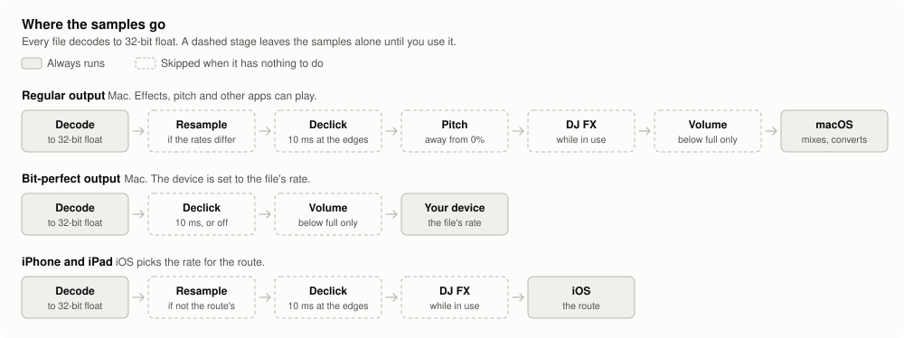

- **Resample** runs only when the file's sample rate differs from the output's.
- **Declick** is a 10 ms fade at transitions, to stop clicks. Settings > Audio Output > Declick turns it off on the Mac. A crossfade can run longer. iOS always declicks.
- **Pitch** stops filtering at 0% once its ramp and its buffered history settle. From then on the samples are exact. [The pitch fader](#the-pitch-fader) has more.
- **DJ effects** drop out once released and once their tails have died away. The low cut ramps flat when released and resets after a quarter of a second. Exact-output tests check it leaves nothing behind.
- **Volume** is Vibe's own fader. At full volume it does nothing.

The equalizer bars read a copy of the output. They never change it.

### Regular output

Vibe plays at whatever rate your output device is set to. A file at another rate is converted once, by Vibe's resampler. The DJ effects and the pitch fader are available. After Vibe, macOS mixes in other apps' sound, converts to your device's format, and applies the system volume.

### Bit-perfect output (Mac)

Turn it on in Settings > Audio Output > Bit-perfect output. It's remembered per device, and it needs a specific device, not "System Output". Before each track plays, Vibe sets up your device:

- **The sample rate is set to the file's.** If the device can't run at that rate, Vibe picks the lowest exact multiple it can. A 44.1 kHz file on a device that only offers 88.2 kHz gets doubled, cleanly. If there's no multiple either, it plays at the device's rate, and the status says it isn't bit-perfect.
- **The device format gets enough precision.** Integer files ask for the smallest integer format that holds them, then float. Float and lossy files ask for the widest float format. Everything passes through 32-bit float. That limits 32-bit integer and 64-bit float sources, whatever the device takes.
- **DJ effects and pitch are off.** Crossfades shrink to the declick. Declick and volume can still change samples. Turn declick off and keep volume at full for exact playback through transitions.
- **Exclusive output** is a separate switch. It locks the device so no other app can play through it.

The caption shows the confirmed device format and anything that stops exact output. That covers rate conversion, channel mapping, too little precision, mute, volume, an unconfirmed device and a refused exclusive lock. Lossy files get their own status, because the decoded samples aren't the compressed file.

By default the mode is allowed on built-in, USB, FireWire, Thunderbolt, PCI, HDMI, DisplayPort, AVB and virtual devices. Bluetooth, AirPlay and aggregate devices are left out. Settings > Advanced can override that. Being allowed doesn't prove a device keeps the samples.

### iPhone and iPad

iOS picks the output rate for where the sound is going: the speaker, headphones or a USB DAC. Vibe converts to that rate when it has to. Otherwise it works like regular output. There's no bit-perfect mode on iOS.

## Lossy files and bit depth

In bit-perfect mode, a lossy file goes to your device as float if the device has a float format. Otherwise it gets the device's highest bit depth. Vibe never picks 16 bits just because a file is lossy.

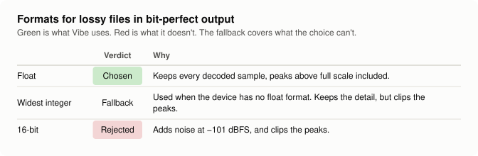

**Why:** MP3 and AAC don't have a bit depth. They store sound in a compressed form, and the decoder rebuilds the waveform as it plays. Some players send MP3s to the DAC as 16-bit, on the idea that "MP3s are 16-bit". A decoder that works at full precision makes more detail than 16 bits can hold, though. Its loudest moments can also go a little past full scale. Cutting that down to 16 bits adds noise, and clipping the peaks adds distortion.

**The data:** how much it matters depends on the decoder.

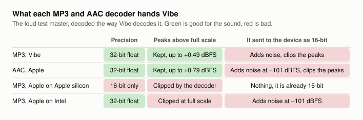

**AAC** is where this matters most. It's the format of iTunes purchases and most lossy files on Apple devices. A float output keeps the decoded AAC exactly, peaks and all. A 24-bit output keeps everything up to full scale, with any change far below hearing (−149 dBFS). Like any integer format, it still clips the peaks. A 16-bit output would add noise only 33 dB below a quiet fade-out, against 81 dB below at 24 bits.

**MP3 with Apple's decoder on Apple silicon** is different. That decoder only makes 16-bit samples. It rounds the audio and clips the peaks before Vibe ever sees it, and there's no setting to ask for more. A common tip says to request 32-bit float output from `ExtAudioFile` or `AudioConverter`. That works on an Intel Mac. On Apple silicon, both were tried. You get floats back, but every one is still a 16-bit value, and the peaks are still clipped. Core Audio converts the 16-bit output to float after the fact. So with that decoder, 16-bit, 24-bit and float outputs all carry the same samples. The only way to get more out of an MP3 is a different decoder. Vibe uses one. With it, MP3 behaves like AAC.

**On an Intel Mac**, Apple's MP3 decoder also offers float, and Vibe asks for it. The detail below 16 bits survives. It matches Vibe's decoder to within 0.06 of a 16-bit step. It still clips every peak at exactly full scale, though. Vibe's decoder keeps them. It's the default on Intel Macs too.

*How this was measured:* the test tracks behave like mastered music. They're tones and noise at CD quality (16-bit, dithered), loud for ten seconds with peaks just under full scale, then fading to −70 dB. A second version was squashed up to full scale, like a modern loud master. They were encoded as MP3 (LAME at 320 kbps and V2) and AAC (Apple's encoder at 256 kbps). Then they were decoded the way Vibe does, and with ffmpeg to compare. The Intel figures come from Vibe's own test files, decoded under Rosetta 2. Rosetta runs the Intel build of Apple's decoder. They haven't been checked on an Intel Mac itself.

## The MP3 decoder

Vibe decodes MP3, MP2 and MP1 with dr_mp3 by default, on both platforms. On the Mac, Settings > Advanced > MP3 decoder can switch to Apple's. Switching reopens the current track at the same position. iOS always uses it.

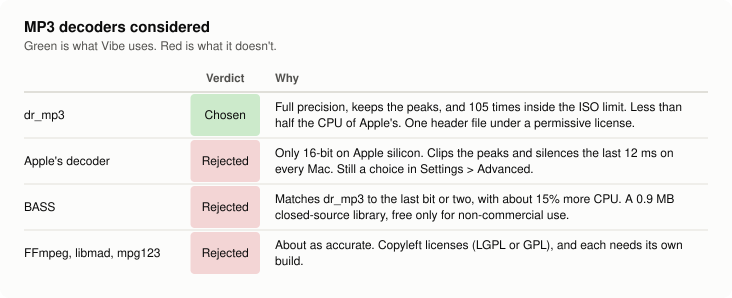

**Why:** on Apple silicon, Apple's MP3 decoder only makes 16-bit samples. That costs three things:

- **Quiet passages lose detail.** Rounding to 16 bits adds a thin layer of noise. On loud music it's far below hearing. On a passage at −70 dB, Apple's error sits only 31 dB below the music. Vibe's sits 127 dB below.
- **Loud masters lose their peaks.** A loud master decodes a little past full scale. Apple's decoder clipped 36,188 samples of the 20-second test master. Vibe keeps them, up to +0.93 dB. Vibe's own volume control (macOS, off by default) can then lower them cleanly. At full volume, an integer output format still clips them. Resampling can make them higher.
- **Some songs lose their last moment.** In an MP3 without gapless info, the last 529 samples (about 12 ms) come from the decoder emptying itself. Apple's decoder makes them silent. Vibe plays them. If the music runs to the very end of the file, Apple's version ends with a small click.

On an Intel Mac, Apple's decoder keeps the quiet detail, but the other two costs remain. Vibe's decoder also uses less than half the CPU. dr_mp3 is one header file under a permissive license, and it needs no extra toolchain.

**The data:**

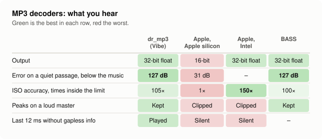

MP3 has an official accuracy test from the ISO (ISO/IEC 11172-4). It comes with test streams and the exact output a perfect decoder should give. A decoder passes at "full accuracy" if its average error stays under a set limit. That limit is exactly the size of 16-bit rounding. A 16-bit decoder like Apple's on Apple silicon lands right on it. Seven of the test streams went through every decoder below.

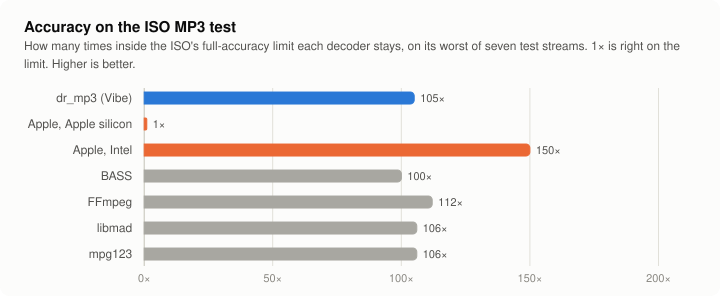

- Vibe stays 105 times inside the limit. Apple's decoder on Apple silicon reaches full accuracy on three streams and only "limited accuracy" on the other four.
- The Intel build of Apple's decoder, under Rosetta 2, reaches full accuracy on all seven. It's 150 times inside the limit on its worst stream, `compl`. It ties Vibe on `si` and is slightly ahead on the other six.
- The full-precision decoders are close. Their differences are about the size of the rounding in the ISO reference files. This test doesn't prove they're equal on every MP3.
- BASS is dr_mp3's close cousin. Its notes say its MP3 decoding comes from minimp3, the same code dr_mp3 comes from. Its output matches dr_mp3's to within the last bit or two of a 32-bit float, about −134 dB.

The limit is an average error below −101.1 dBFS, with no single error above 6.1e-5. libmad was read at its full internal precision, finer than its usual 24-bit output. Apple's decoder and BASS both remove the 529-sample start-up delay. Their output was lined up 529 samples later to match. The streams come from FFmpeg's test-file mirror. A test runs this check on every change. It fails if Vibe's decoder is ever less than 50 times inside the limit. That would catch a slip back to 16-bit output. The ISO's streams can't be included in the repo. The test downloads them, and skips if it can't.

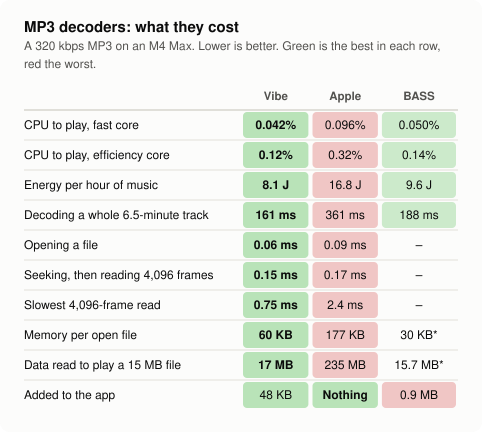

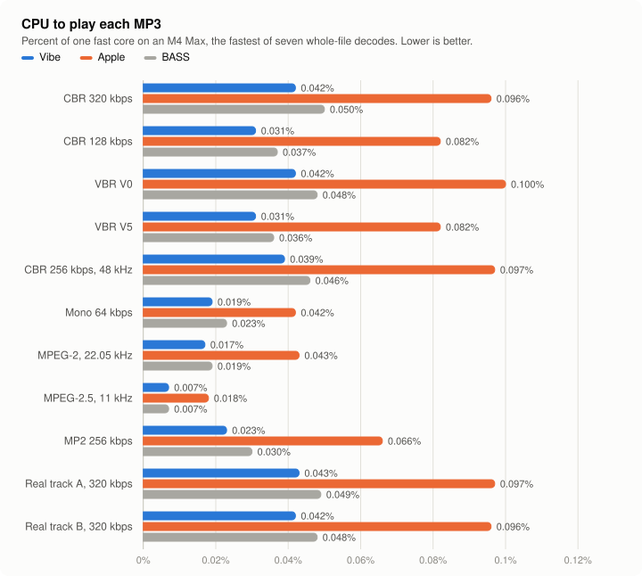

- **Both are cheap.** Playing a 320 kbps MP3 takes about 0.1% of one core with Apple's decoder and 0.04% with Vibe's. You won't feel that during playback. It shows on slower cores, and when a whole track is decoded at once for the waveform. That's 2.2 times faster with Vibe's.
- **Vibe's decoder does less work.** It used less CPU than Apple's on all 11 files. It runs 2 to 3 times fewer instructions. BASS comes second, about 15% behind Vibe. An hour of music costs 8.1 joules to decode with Vibe's decoder and 16.8 with Apple's. A phone battery holds about 50,000.
- **Apple's decoder rereads the file.** It reads 64 KB at a time and goes back over the same part of the file many times, 15 to 40 times the file's size in one playthrough. In the test the file was already in memory. That cost time (about 10 ms a track, against 1–3 ms) but no disk reads. A slow drive and a network share weren't tested.
- **dr_mp3's memory** is 23 KB of decoder state, about 21 KB for 16 compressed frames read ahead, and 9 KB for one frame of sound. The rest is macOS's file reader.
- **\* BASS reads the file itself.** Both of Vibe's decoders share macOS's file reader. Those two BASS figures aren't like for like. With real embedded artwork, BASS also held 174–414 KB of tags in memory.
- **A read has lots of time.** Each 4,096-frame read covers 93 ms of music, and the slowest took under 3 ms. On efficiency cores both decoders had rare reads of 45–77 ms. That came from the test's lowest thread priority on a busy machine. The app's decode thread runs at the highest priority, and each track keeps at least a second of audio buffered.

*How this was measured:* Vibe's own file reader with the app's Release build settings, switching decoders run by run, on an M4 Max. BASS 2.4.18 decoded the same files with its own reader, in the same session. The files were one real 6.5-minute track encoded nine ways, plus two real 320 kbps tracks. No iPhone or Intel Mac was measured.

### How it fits in

- **macOS still reads the file.** It opens it, reads its tags and gapless info, and finds each frame. dr_mp3 only turns frames into sound. So every track has the same length and plays gaplessly, exactly as with Apple's decoder. On 16 test files the lengths matched exactly. On Apple silicon the sound differed only by Apple's 16-bit rounding, at most 4 steps of a 16-bit value.
- **The decoder delay is removed.** Vibe drops dr_mp3's first 529 samples for MP3, and 241 for MP1 and MP2. A silent frame at the end flushes the rest out.
- **Seeks land on the exact sample.** An MP3 frame can borrow data from the frames before it. So dr_mp3 starts at least ten frames before the target and throws them away. In the tiny frames of an 8 or 16 kbps MP3 the borrowing reaches further, up to 80 frames in the 8 kbps tests. There, Vibe works out how far back from the frame sizes. A seek gives exactly the sound that playing from the start gives.
- **A damaged frame is capped at +12 dB.** Corrupt data can decode to huge peaks that ring through effect tails and throw off analysis. The cap is well above real overs. The loudest undamaged peak in the measured library was +8.6 dB.
- **Damaged and cut-off files end where Apple's do.** MP3 and MP2 inside WAV work too, when every frame is the same size, like 48 kHz CBR. macOS refuses 44.1 kHz and VBR ones with either decoder, and rare free-format MP3s.
- **MP2 plays on the iPhone.** iOS has no MP2 decoder of its own.
- **Not tested yet:** MP1 files, for lack of an MP1 encoder, and CPU on an iPhone. dr_mp3 decodes MP1 with MP2's timing. MP1 shares that timing.

### Changes to dr_mp3

- **Two fixes.** dr_mp3 misread frames with any of their "private bits" set. Encoders can use those bits as they like. It also misread 8 kHz files with mixed blocks, a rare kind of frame, and wrote past the end of a buffer there. Vibe's copy decodes both the way FFmpeg and mpg123 do. Neither kind turned up in 1,065 real MP3s, and all of them decode the same with or without the fixes.
- **Reading 16 frames at a time.** Asking macOS for one frame at a time made about four small reads per frame. That was a tenth of the decode time. 16 at a time saved it. 4 saved half as much, and 64 no more than 16.
- **One Accelerate call to split stereo.** dr_mp3 hands back left and right mixed together, and playback wants them apart. One `vDSP_ctoz` call does it, and saves about 3%.

Together those cut decode time by 13–18%. Some things didn't help. `-O3` (what ships) was as fast as any build setting. `-Os` is 8% slower, and turning off dr_mp3's hand-written NEON code is 16% slower. Faster float math didn't help. Accelerate inside the decoder didn't either, because its transforms are too small. About half the decode is reading the compressed bits. Each value there depends on the one before, and vector instructions can't help with that.

## The FLAC decoder

Vibe decodes FLAC with dr_flac on the Mac and the iPhone. There's no setting, because there's nothing to hear. FLAC is lossless, and both decoders return exactly the encoded samples. On all 1,394 FLAC files of a real library that Apple's decoder opens, dr_flac's output matched Apple's bit for bit, and so did every seek.

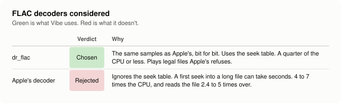

**Why:**

- **Seeking.** Apple's decoder never uses a FLAC file's seek table. The first time you seek into a part it hasn't read, it reads the whole file from the start up to that point, and the sound waits. Resuming a track where you left off is a seek too. Vibe's decoder finds the spot in a few small reads, from the seek table or by bisecting the file.
- **A quarter of the CPU or less.** It shows most when a whole track is decoded for the waveform, tempo and key.
- **It reads the file once.** Apple's decoder reads 2.4 to 5 times the file's size to play it.
- **Files Apple's decoder refuses play.** These are legal FLAC files that some encoders write: block sizes of 16 or 65,535, rates above 655 kHz such as 705.6 kHz, and 32-bit files.
- **Damaged files keep their timing.** Vibe's decoder fills a damaged stretch with silence up to the next good frame. A cut-off file ends where the data ends. A file that doesn't say how long it is can still play, because the decoder searches back from the end for the last good frame.
- **The last moment of a file with an ID3v1 tag.** Apple's decoder drops the last frame (about 30 ms) when an ID3v1 tag follows it. Vibe plays it.

**The data:**

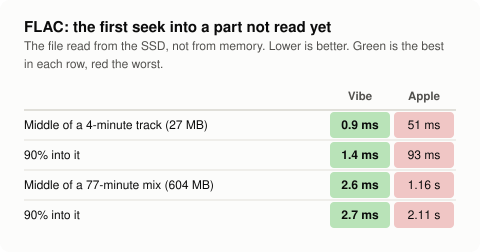

After the first seek, Apple's decoder seeks in 0.2–0.3 ms, until you seek past the part it has read and it scans again. Vibe's took 2.1 ms at most over 1,500 seeks on five files.

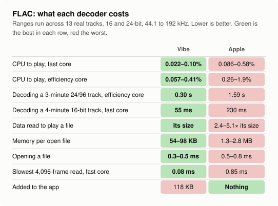

*How this was measured:* Vibe's own file reader with the app's Release build settings, with each decoder in turn, on an M4 Max that was busy with other work. Each figure is the best of five runs. The library was 1,397 FLAC files from ordinary sources: CD rips, web stores, downloads and sample packs. Every file but three empty ones was decoded in full by both decoders and compared sample by sample, with 25 seeks each. "Read from the SSD" means a fresh copy of the file, none of it in memory. No iPhone was measured.

### Fixes to dr_flac

Most of these turned up in real files from that library. The rest came from test files made for the rare cases, from fuzzing and from simulated damage.

- **A tag in front of the music.** Some taggers put an ID3v2 tag before the FLAC data. dr_flac read from the wrong place and played noise, cut the track short or refused it (17 files, 1.2%).
- **Seeks that failed.** A kind of frame encoders can legally write could be decoded but not skipped. Some seeks failed and would have stopped the track (33 files, 2.4%).
- **Stale seek tables.** A file edited after encoding can keep a seek table that points at the wrong frames. dr_flac trusted it and landed up to 0.85 s early. It now checks where it landed.
- **Seeks that read the whole file.** On a file with no seek table (39% of the library), a few percent of seeks read most of the file, up to 1.9 s on a 77-minute mix. Vibe's search does those in a few milliseconds.
- **Damaged frames.** dr_flac skipped a damaged frame. Everything after it played early, or the track stopped. It now plays silence in its place. Fuzzing found more cases, like a short frame taking the good frame after it, and a bad header adding minutes of silence. On 1,200 simulated damaged files, 181 lost or moved a good frame before. Now every good frame plays in its place, except in one file whose damage erased its last frames.
- **Seeks near damage, and garbage in seek tables.** A seek to a damaged frame landed 93 ms late. One flipped bit in a seek table could stall a seek for five seconds. It now takes under a millisecond.
- **Cut-off downloads.** A seek past the end of an unfinished download failed. It now lands at the end, and the next track plays. Seeking into the empty end of a download that reserved its full size took 1 to 2.5 s. Now it takes about 0.2 s.
- **32-bit files, and files that don't say how long they are.** dr_flac could open 32-bit files but not play them. In a file with no length, every seek went back to the start. dr_flac now finds the length when it opens the file.
- **Files made with an encoder's most extreme settings.** They can split each frame into more than 256 parts. That's valid FLAC, but dr_flac took every such frame for damage and played silence. Apple's decoder stops partway through the same files.
- **Seeks in very long files.** A seek of more than about 6 hours at 192 kHz (27 hours at 44.1 kHz) from inside a frame stayed in that frame.
- **Crashes and undefined behavior,** all in rare or damaged files.

### Tuning dr_flac

These changes halve the work of decoding. Across 17 library files, 16 and 24-bit, 44.1 to 192 kHz, Vibe's dr_flac takes 51% fewer CPU cycles than upstream, and every file is 49–53% cheaper. The output is identical, bit for bit, on every file in the library. With the fixes, it's 118 KB of code, against upstream's 80 KB.

- **The checksum, eight bytes at a time.** Every FLAC frame carries a checksum. dr_flac worked it out one byte at a time, each step waiting on the last. That was a fifth of a 16-bit file's decode time and half of a 24-bit file's. Tables that work on eight bytes at once cut it to 2%.
- **New NEON code.** Upstream's hand-written NEON code is slower on Apple silicon than its plain C, 60% slower on 16-bit files. Its way of predicting each sample keeps the vector unit waiting on the one before. Vibe's version keeps the newest few samples in ordinary registers and leaves the older ones to the vector unit. It's 23% faster than the plain C on 16-bit files, 20% on 24-bit, and twice as fast as upstream's NEON. It also covers prediction orders above 12. Upstream leaves those to plain C.
- **Straight into each channel.** Vibe mixes a channel at a time, and dr_flac decodes a channel at a time. Upstream interleaves the channels, and Vibe would then split them again. Vibe's copy writes each channel to its own buffer. That cuts 9–14% on the fast cores. A 10-minute 16-bit file went from 104 to 89 ms, and a 24/96 file from 241 to 219 ms.
- **Fewer, larger reads.** dr_flac asks for 4 KB at a time. Vibe's file handle answers from a 16 KB fill of the 64 KB block it already keeps for CoreAudio's parser. That's a quarter of the reads and 2–4% less decode time, with no extra memory. A seek probe fills only 16 KB. Seeks cost the same as before.

One change was left out. Giving up early on a long run of zeros inside a frame sped up damaged files, but slowed every normal file by 2%.

## The WAV and AIFF decoder

Vibe decodes WAV, BWF, RF64, Wave64 and AIFF with dr_wav on the Mac and the iPhone. That covers 8 to 32-bit integer, 32 and 64-bit float, A-law and µ-law, and the three ADPCM kinds: IMA and Microsoft's in a WAV, and Apple's IMA4 in an AIFF. Anything else falls back to the right decoder. MPEG inside a WAV can use Vibe's MP3 decoder. Files above dr_wav's 384 kHz limit fall back too. There's no setting. On all 10,823 WAV and AIFF files of a real library that both decoders open, dr_wav matched Apple's output bit for bit, and so did every seek.

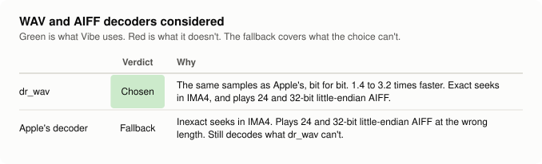

**Why:**

- **It's faster.** It decodes 1.4 to 3.2 times faster than Apple's decoder. That shows when a whole file is decoded for the waveform, tempo and key.
- **Exact seeks in IMA4.** In Apple's IMA4 (compressed AIFF), each part of the sound depends on everything before it. After a seek, Apple's decoder plays slightly different samples than playing from the start does. That happened on all 300 of 300 random seeks in a test file. Vibe's decoder keeps notes on its way through the file. A seek gives exactly the samples playing from the start gives.
- **Damaged compressed WAVs keep playing.** At a damaged block in an IMA ADPCM file, Apple's decoder decodes it anyway. At one in a Microsoft ADPCM file, it plays nothing of the file at all. Vibe's plays silence for the bad block and every other block in its place.
- **The end of a Microsoft ADPCM file.** Apple's decoder plays the padding in the last block, 464 frames (about 10 ms) in a test file. Vibe's stops where the file says the sound ends.
- **24 and 32-bit little-endian AIFF.** Apple's decoder reads these as 16-bit and plays them wrong, one and a half or two times as long as the music. Vibe plays them right. Convert to FLAC reads them the same way.

**The data:**

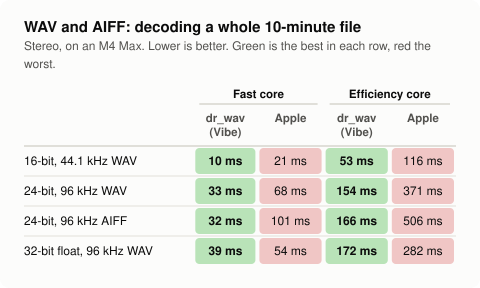

The ADPCM formats are the exception. They take about as long as Apple's decoder, and IMA4 about 60% longer. That's a few milliseconds for 20 seconds of sound.

*How this was measured:* Vibe's own file reader with the app's Release build settings, with each decoder in turn, on an M4 Max. Each fast-core figure is the best of five runs. Each efficiency-core figure is the middle of three, because those runs vary more. The library comparison opened 17,917 WAV and AIFF files from music projects, sample packs and the Ableton Live factory library the way Vibe does. Every file both decoders open, 10,823 of them, was decoded in full by both and compared sample by sample, with 50 seeks each. No iPhone was measured.

### Fixes to dr_wav

- **Seeks in tagged AIFF files landed late.** dr_wav counted 8 bytes of an AIFF's header as sound. In a file with anything after the sound, like the tags Ableton Live writes, every seek landed a sample or two late. That was 278 of the library's 749 AIFF files.
- **AIFF-C in µ-law and A-law** played every sample wrong.
- **8-bit files** had a slight offset under the whole track, about −48 dBFS.
- **The length a file claims.** dr_wav trusted the length an AIFF or a compressed WAV states, even when the file holds less, like a cut-off download. It then seeked to the wrong place. It now plays what the file holds.
- **Unfinished recordings.** A recording that was never finished leaves its length at zero or at its maximum, and a WAV past 4 GB overflows it. dr_wav played none of those, or only part. It now plays them in full.
- **Long seeks.** Seeks more than about an hour into a 24/96 file left dr_wav's position one sample off.
- **AIFF files dr_wav refused.** That covered the AIFF-C types Apple's own tools write for 16, 24 and 32-bit sound, IMA4, and a few header layouts other programs write. All of them play now.
- **Damaged compressed WAVs** lost the bad block from the timeline, shifting everything after it earlier, or stopped the track.
- **Files that made it hang or misbehave.** Fuzzing found sizes in damaged files that made opening or seeking take billions of steps, and arithmetic that C leaves undefined.

### Tuning dr_wav

- **Straight into the output.** Upstream reads through a 4 KB buffer and converts each sample through double precision. Vibe's copy reads the samples in one go into the memory they're converted in. It converts them with vector instructions, to exactly the same values.
- **Straight into each channel.** dr_wav converts stereo straight into a buffer per channel. That saves a second pass and cuts 16 and 24-bit decoding by 20–30% on the fast cores. Reading a whole file for the waveform asks for it in one piece instead of 4,096 frames at a time. That cuts it by 15–20%.
- **Reading ahead in ADPCM.** Upstream reads ADPCM a few bytes at a time, one read per sample in a Microsoft ADPCM file. Reading ahead makes those files 15 to 45 times faster to decode.
- **Seeking to the right block.** Upstream decodes from the start for a seek backwards in an ADPCM file. Vibe's copy goes straight to the block it needs.

## The resampler

When a file's sample rate differs from the output's, Vibe converts it with r8brain-free-src. It runs at its highest-precision setting, with a steep filter at the top of the band.

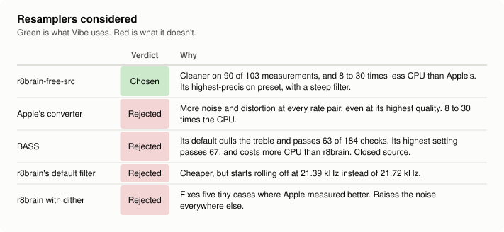

**Why:** changing the sample rate is the one job where Vibe has to change your samples. It gets the strictest test. It was measured against Apple's converter at its highest quality, both inside Vibe's player, with the same test signals, at the eight rate changes a music library is likely to need. Across 103 measurements of noise, distortion and false tones, Vibe's did better in 90. Apple's converter did better in 8, all between −157 and −173 dB, far below hearing. It removed false tones 4–9 dB more thoroughly. It also used 8 to 30 times less CPU.

The test signals were pure tones near full scale, a very quiet tone, a sweep from low to high, a sawtooth, twenty tones at once compared against a perfect copy, the CCIF and SMPTE intermodulation tests, a single click, a tone whose peaks fall between samples, silence, and a steady level. The tests also checked flat response to 20 kHz, exact timing and length, and CPU.

**The data:**

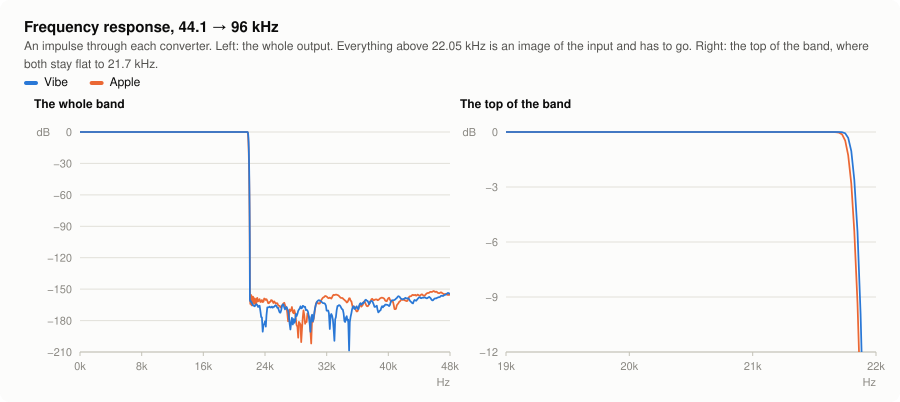

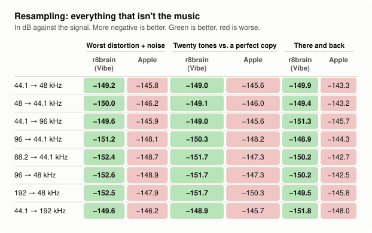

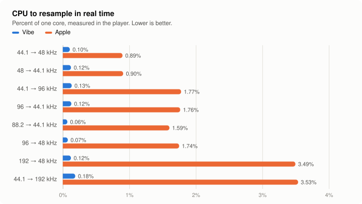

The in-player CPU figures were measured alongside other tests. They're a little noisy. On an iPhone 17 Pro, converting a 44.1 kHz file to the phone's 48 kHz took 0.54–0.56% of a core with Vibe's and 3.27–3.39% with Apple's converter. That's about six times less.

### How r8brain is set up

- **Its highest-precision preset,** made for 24-bit and float audio. It removes false tones by about 180 dB.
- **A steep filter at the top.** From a 44.1 kHz file, the response is flat to 21.72 kHz and 3 dB down at 21.83 kHz, within 30 Hz of Apple's. r8brain's default starts rolling off earlier, at 21.39 kHz. The steeper filter costs about 20% more CPU. That's still tiny.
- **Aligned output.** The converter makes up for its filter's delay. It still needs some input buffered before it can produce output.
- **64-bit math inside,** rounded once to 32-bit float at the end.

### Why there is no dither

Dither is a little added noise that hides the effect of rounding. r8brain's one rounding, from 64-bit to 32-bit float, is already tiny. A very quiet tone's error measures −209 dBFS. Dither was tested on the few cases where Apple's converter measured better. It would fix those, but it raises the noise everywhere else by about as much, and that matters more.

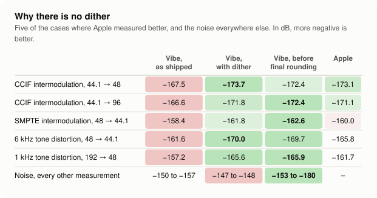

Before its final rounding, r8brain matches or beats Apple's converter everywhere. So those few gaps come from rounding to 32-bit float, not from r8brain. All of them are far below hearing.

### Setups tried

This is a separate, quieter benchmark: two minutes of stereo per rate change, the middle of three runs. Starting a conversion took under half a millisecond. Extra FFT padding is r8brain's `R8B_EXTFFT` switch.

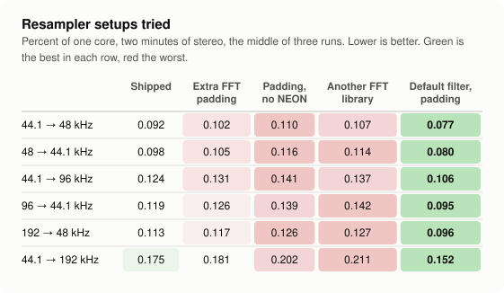

r8brain's default filter is the cheapest, but it rolls off the top end earlier. Vibe uses the steeper one.

### BASS, tested and not used

BASS (2.4.18.3, with BASSmix) is an audio library many players use. Its resampler was tested the same way, at its default setting (16-point) and its highest (256-point). It keeps the level and length right. It passed only 63 (default) and 67 (highest) of the 184 checks. Apple's converter and r8brain pass all 184.

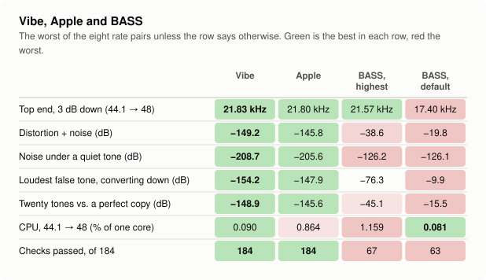

- **The top end.** At its default, BASS rolls off the treble early, 3 dB down by 15–19 kHz. You can hear that. At its highest it stays flat to 20–22 kHz, like the others.
- **False tones.** BASS's filter doesn't fully block sound near the rate's limit. Some of it comes back as false tones. That's also why a 20 kHz test tone shows so much distortion.
- **Noise.** For most rate changes BASS adds noise at about −126 to −142 dBFS, where the others reach about −206 to −212. For exact 2:1 and 4:1 changes BASS is as quiet as the others. So the noise comes from how it works out in-between samples, not from a lack of precision.
- **CPU.** BASS doubles its CPU with each quality step, because it filters the direct way. For 44.1 → 48 kHz that's 0.078% of a core at 16-point and 1.2% at 256-point. Vibe's resampler and Apple's converter use smarter methods that stay cheap with steep filters.
- **What you'd hear.** At its highest setting, almost certainly nothing. At its default, slightly dull treble. BASS wasn't chosen because r8brain is more accurate on every measure, and BASS at its highest costs more CPU than r8brain. BASS is also closed source, and free only for non-commercial use.

## The pitch fader

The pitch fader changes speed and pitch together, like a turntable, by up to 8% or 16%. Since 1.16 it uses Vibe's own converter, not Apple's Varispeed. The fader is on the Mac only, and never in bit-perfect output.

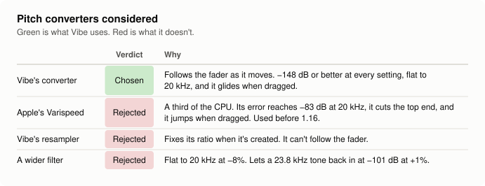

**Why:** the fader needs a ratio that follows your hand. Vibe's resampler fixes its ratio when it's created, and prepares samples ahead of time. It can't follow a moving ratio. Apple's Varispeed can, but it's much dirtier. Its error grows 12 dB per octave, the sign of a coarse filter table. It can't be tuned away. It already runs at its highest quality, and it refuses Apple's Mastering setting. It also cuts the top end.

**The data:** both measured through Vibe's player with the same test, at −16%, −8%, −1%, +1%, +8% and +16%, at 48 kHz. Each tone is measured at exactly its frequency. Anything that isn't the tone counts against the converter. 32-bit float sets a floor of about −150 dB.

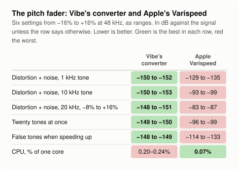

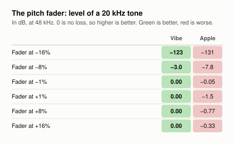

Slowing down moves everything in the file down with it, the top end included. At −8%, a 20 kHz tone comes from 21.7 kHz in the file. That's on the filter's slope. At −16% it comes from 23.8 kHz. No converter keeps that. At 96 kHz the filter scales with the rate. There Vibe's converter measures −148 to −152 dB on every row, and a 20 kHz tone stays at 0.00 dB at every setting, −16% included.

Apple's Varispeed takes about a third of the CPU, 0.07% of a core against 0.20–0.24%. That's measured on an M4 Max in the `pitch` component benchmarks. Both are tiny.

- **The filter** is a windowed sinc, the standard design for resampling. It's 64 input frames each side before stretching, with a Kaiser window (β 15.6) and about 150 dB of stopband.
- **It keeps the top end.** It's flat to 20 kHz and 6 dB down at 22 kHz at 48 kHz, and it scales with the rate.
- **No false tones when speeding up.** The filter stretches with the speed. Its top follows the output's limit.
- **Smooth drags.** When you move the fader, the speed glides across each block of audio instead of jumping. Apple's unit jumps. That adds side tones 60 to 63 dB below the music as the fader moves. The glide brings them down to −98 dB on an 8 kHz tone and −116 dB on a 1 kHz tone.
- **64-bit sums,** rounded once to 32-bit float at the end.
- **A short delay:** 64 samples, about 1.3 ms at 48 kHz, and up to 75 when speeding up by 16%.
- **Timing follows the fader.** The converter takes source samples in order at the chosen speed. The tests check that through a seek, a pause, a gapless track change, a change of output rate, and every sample of a six-and-a-half-minute track. They cover the converter's delay, not the output device's. The track ends on time.
- **A wider filter didn't work.** With 96 zero crossings and the cutoff at 22.9 kHz, 20 kHz stays flat at −8%. Its stopband starts too close to the output's limit, though. At +1%, a 23.8 kHz tone comes back at −101 dB.

Key lock is a different feature. It changes tempo without changing pitch, and needs a time-stretching algorithm, not a resampler. `scripts/analysis/varispeed-quality/run.sh` measures Apple's Varispeed, Vibe's resampler at a fixed ratio, and a prototype of this converter outside the player, with no audio device. It times them too, and measures a drag. It's the place to try a new filter design before it goes into the player.

## How it's tested

These run on every change, with no audio hardware:

- **Every sample is checked.** The real player plays into memory, and every sample of every channel is compared with the file. That covers 44.1 to 192 kHz, 16-bit, 24-bit and float, mono and stereo, and the generated format fixtures. Bit-perfect and regular playback must match the file exactly. The only exception is the first 50 ms, as declick fades in, and not even that with Declick off. The check catches one changed bit, a dropped or repeated sample, swapped channels or flipped polarity.
- **Unused features change nothing.** The file must play back exactly with the effects on but unused, with the equalizer bars running, with the pitch fader at 0%, and after every effect has been used and released. That covers each effect key, the boost, the iOS effects pad, and an effect switched off partway through. Exactly means exactly, not "within a tolerance". A released low cut left in the path changes the audio by about 0.0000000000007, and only an exact comparison catches that.
- **The pitch fader** must keep distortion, noise and false tones below −145 dB at six settings from −16% to +16%, at 48 and 96 kHz. It must stay flat to 20 kHz from −1% up. Leaving 0% and coming back must not click, skip or repeat a sample, at every rate from 44.1 to 192 kHz and in mono. At 0% the file must play exactly, and so must a track that plays on after the fader returns to 0%. Away from 0%, it must not skip or repeat a sample through a seek, a pause, a gapless change, a rate change or a six-and-a-half-minute track.
- **The resampler** must pass every measurement above at all eight rate changes. It must carry on seamlessly across gapless track changes, and match the same conversion done outside the player, exactly.
- **The MP3 decoder** must stay at least 50 times inside the ISO limit. It must match Apple's decoder in length and timing on every kind of MP3 and MP2, including MP3 inside WAV. It must keep a loud master's peaks and seek to the exact sample, including in 8 kbps files. It must decode private-bit frames and 8 kHz mixed blocks as FFmpeg does, cap a damaged frame at +12 dB, and end cut-off files where Apple's does. Switching decoders must drop a prefetched track opened with the old one.
- **The FLAC decoder** must decode every test file to exactly the samples it was made from, including the ones Apple's decoder refuses and 32-bit files in each stereo mode. Every seek must land on the exact sample. Files damaged the ways real files get damaged must play as described above. That covers a tag in front, a stale seek table, a garbage seek-table entry, a damaged frame, frame header or first frame, bytes lost inside a frame, a damaged frame the seek table points at, downloads cut off all across a frame, and a file with no length, alone and with a megabyte of zeros after it. Frames split into more than 256 parts must decode exactly. A file more than 2^32 samples long must seek forward and back across that distance.
- **The WAV and AIFF decoder** must match Apple's decoder on the supported fixtures, including the AIFF-C types Apple's tools write, IMA4, and both ADPCMs in a WAV. Every seek must land on the exact sample. Damaged files must play as described above: a chunk after the sound, a file cut short, a length larger than the file, unfinished sizes, the format after the sound, a damaged ADPCM block, and a Microsoft ADPCM file cut off inside a block. A Microsoft ADPCM file with its own coefficient table must decode with that table, as Apple's decoder does.
- **Lossy files** must match their own decoded audio exactly. AAC gets four tiny rounding steps (below −126 dBFS), because two runs of Apple's AAC decoder can differ that much. The test also checks which formats Apple's decoders can output. Any change there fails it.

On the Mac there's also an optional test that plays through a real output device and records it back, to compare the captured stream with the source. It doesn't test a DAC's analog output.

The charts and tables on this page are drawn by `python3 scripts/docs/audio_quality.py`. The numbers live in that script, and the frequency response curves in `audio-quality/response.json`.
