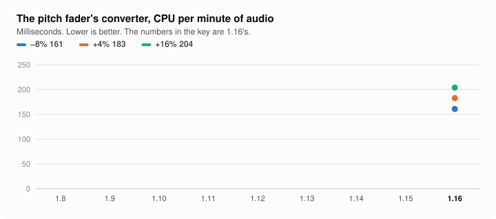
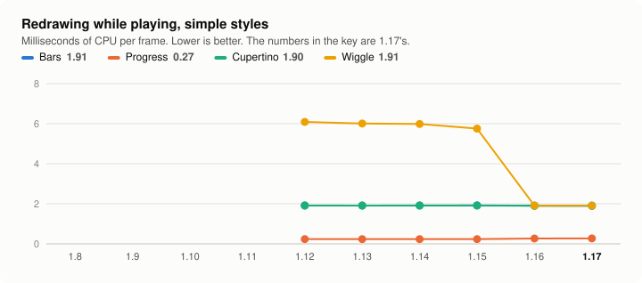
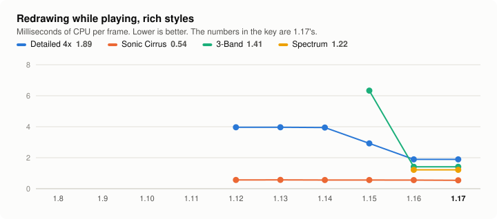
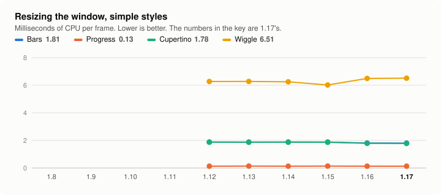
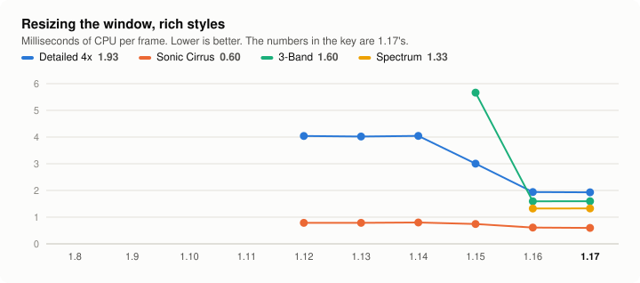
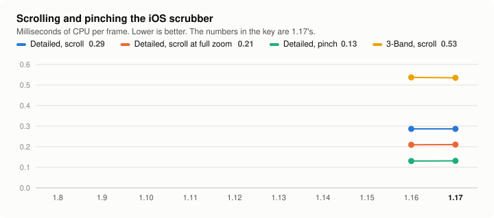

# Performance

Every release of Vibe runs the same benchmarks, on the same Mac. That shows what got faster, what got slower, and which change did it. This page has the results, and the reasons behind the big moves.

There are two kinds of benchmark. The app benchmarks launch each release's own app and play real files through the speakers. The component benchmarks run the code under each feature directly, with no app around it. Lower is better on every chart and table here.

<!-- performance:begin -->

Both suites ran on an Apple M1 Max with 64 GB of memory and macOS 27.0.1. A version marked pre-release was measured before its release was tagged.


<!-- performance:end -->

## Playing a track

In 1.14, Vibe's own audio engine replaced Apple's AVAudioEngine. It plays straight to the output device.

**Why:** Vibe's engine keeps the output running when the track changes. The next track only has to open its file and start decoding. With AVAudioEngine, a track switch took about 40 ms.

**The data:** a track switch took about 40 ms through 1.13. It takes 6 ms now. The first file after launch still has to start the output. It takes about 40 ms. An MP3 with no Xing header has no frame count and no seek table, so it takes more work to open. It took 47 ms in 1.8 and takes 10 ms now. App launch has drifted from 215 ms in 1.8 to 234 ms in 1.17. 1.16 took 252 ms, and 1.17 gave most of that back. The second chart is the open alone, in CPU. 1.16 made opening an MP3 ten times more expensive, at 0.55 ms, and 1.17 fixed it. Opening an AAC file has cost about 0.4 ms more since 1.14.


## Seeking

The 1.14 engine seeks without stopping the output. In 1.15, Vibe's FLAC decoder replaced Apple's.

**Why:** Apple's FLAC decoder ignores the seek table in a FLAC file. To seek into a part it hasn't read yet, it reads the file from the start up to that point. Vibe's decoder uses the seek table, or bisects the file when there isn't one. [Audio quality](audio-quality.md#the-flac-decoder) has the rest of that decision.

**The data:** a seek in a 3-minute file took about 60 ms through 1.11. 1.12 made every seek about 20 ms slower, and 1.14 took that back along with the rest, to 9 ms. 1.15 took it to 3 ms. FLAC 24/192 still took 22 ms in 1.14, because of Apple's decoder. With Vibe's it takes 4 ms. The CPU behind one FLAC 24/192 seek, with the first read after it, went from 15 ms to 0.6 ms.


## Decoding

Vibe's decoders replaced Apple's for MP3 in 1.14, and for FLAC, WAV and AIFF in 1.15. In 1.16, libvorbis replaced Apple's Vorbis decoder. AAC still uses Apple's decoder.

**Why:** they keep every bit of the audio and use less CPU. Each one is measured against Apple's decoder in [audio quality](audio-quality.md).

**The data:** decoding a minute of MP3 went from 83 ms of CPU to 34 ms. A minute of FLAC 16/44.1 went from 92 ms to 16 ms, and a minute of FLAC 24/192 from 615 ms to 78 ms. AAC costs 31 ms in every release. Since 1.14 Vibe asks Apple's AAC decoder for 32-bit float instead of 16-bit, for the precision described in [lossy files and bit depth](audio-quality.md#lossy-files-and-bit-depth), and that costs nothing measurable here.


## Playback CPU

Three releases cut the CPU it takes to play a file, and one spent a little of it back:

- 1.12 made the UI's playback updates cheaper. Formatting the time readout had been most of each update.
- 1.14 brought Vibe's own engine, and its MP3 decoder and resampler.
- 1.15 brought Vibe's FLAC, WAV and AIFF decoders, and slowed the player's timer from 100 checks a second to 10.
- 1.16 replaced Apple's Varispeed with Vibe's own pitch converter. It sounds much cleaner. It costs about three times as much CPU as Apple's. That's still a fraction of a percent of a core. [Audio quality](audio-quality.md#the-pitch-fader) has the numbers. Playing FLAC 24/192 at +8% pitch went from 6.1% of a core to 7.6%, and MP3 320k at −8% from 1.3% to 2.7%.

**Why:** a music player should cost close to nothing during playback. The savings matter most on a laptop battery.

**The data:** MP3 320k went from 4.0% of a core to 0.7%, and FLAC 16/44.1 from 3.9% to 0.6%. FLAC 24/192 went from 7.9% to 1.7%. The speakers in these tests run at 48 kHz. Every other rate gets resampled, 44.1 kHz included. FLAC 24/352.8 needs the most resampling, and it went from 12% to 2.0%. With every effect on, CPU fell less, from 11.2% to 6.4%, because the effects themselves are most of that work.




## When nothing is playing

When it's paused or idle, Vibe should do close to nothing. With nothing loaded, the 1.14 engine does no work at all.

**Why:** an app that wakes the CPU often keeps it from sleeping, even if each wakeup is cheap. That costs battery.

**The data:** CPU while paused went from 2.3% of a core to 0.24%. With nothing loaded it has been 0.06% in every release. 1.14 got one thing wrong. Its player timer ran 100 times a second whenever a track was loaded, playing or paused. That took wakeups while playing from 2 a second to 103, and while paused from 1 to 61. It also raised the energy of playing FLAC 24/192 from 11 mW to 18.5 mW, even though CPU went down. In 1.15 the timer runs 10 times a second. It goes back to 100 only when a fade, a track change or the end of a file is coming up. Wakeups while playing dropped to 12. FLAC 24/192 now takes 5.2 mW.


## Waveform, tempo and key

A new track gets a waveform and a tempo, and on the Mac a key. All three come from one pass that decodes the whole file. Since 1.15, files at 88.2 kHz and up are converted down to 44.1 or 48 kHz before tempo and key detection.

**Why:** the pass is mostly decoding. The faster decoders did most of the work. Tempo detection works in samples. A 96 kHz file cost twice as much as the same music at 48 kHz. On 150 test tracks converted to 96 kHz, tempo accuracy stayed at 82.3%.

**The data:** a 3-minute MP3 went from 258 ms to 127 ms with the new MP3 decoder. A 3-minute FLAC went from 286 ms to 56 ms with the new FLAC decoder, and a 3-minute FLAC 24/192 from 1.9 s to 0.25 s. A 60-minute MP3 went from 5.0 s to 2.2 s. Tempo detection on a minute of 96 kHz audio went from 24 ms of CPU to 16 ms in 1.15. At 44.1 kHz it has been 10.5 ms in every release.


## Libraries and tags

Vibe has no library to import. When you open a folder, it lists the files right away. Then it reads tags and cover art in the background. It caches what it reads on disk, keyed by each file's size and modification time.

**Why:** you can open any folder and play right away, and the second time is faster.

**The data:** since 1.10, reading a file's tags also makes the smaller copies of its cover that the app shows. That's the jump at 1.10 in the second chart. Reading one file's tags went from 0.08 ms to 9 ms. 1.15 cut it to 6 ms. It decodes the JPEG at a smaller size first, then scales it with vImage. 1.15 also made the disk cache faster. A cache hit went from 115 µs to 28 µs, and opening the cache at launch from 18 µs an entry to 5 µs. A first scan of the 600-file library took 0.33 s in 1.8, 0.53 s in 1.10 and takes 0.42 s now. A scan with a full cache takes 0.07 s. Listing the 600 rows takes 35 ms in every release. The last chart is the big cases. 1.15 took the metadata sweep of 5,000 files from 4.6 s to 0.8 s, and 1.16 halved the cost of editing a 100,000-row playlist.


## Memory

Peak memory fell from 106 MB to 65 MB in 1.10. That release fixed several leaks and reworked library and artwork loading. It's 61 MB now. Idle memory went up from 32 MB to 41 MB in 1.14 with the new engine. It's 40 MB now.


## Drawing the waveform

The waveform is redrawn on every playback tick and on every frame of a window resize. On iOS, the zoomed scrubber redraws on every frame of a scroll or pinch. Each style costs a different amount. These charts measure the CPU behind one frame of each, drawn on the Mac at 2x. The iOS scrubber draws at 3x.

**Why:** the most expensive style sets how smooth a resize feels, and the zoomed scrubber has to keep up with a finger. The GPU and the window server aren't counted here. They draw the finished picture, and the CPU cost of making it is what a style can change.

**The data:** Bars and Cupertino have cost 1.9 ms a frame since 1.12, and Progress, which draws no waveform, 0.3 ms. 1.15 cut Detailed from 4.0 ms to 2.9 ms. 1.16 did the rest. Every style started drawing a picture at fixed zoom steps, which the iOS scrubber scrolls and pinches. Detailed fell to 1.9 ms a frame, 3-Band from 6.3 ms to 1.4 ms, and Wiggle's redraw from 6.0 ms to 1.9 ms. Spectrum arrived at 1.2 ms. Spectrum also mixes its color and brightness in one SIMD vector, and a finished waveform remembers the loudest of each band's columns, so a resize doesn't scan for it again. Wiggle's resize is the one case left at 6.5 ms. Every new width strokes its line again in Core Graphics. On the iOS scrubber, a scroll or pinch frame costs 0.1 to 0.5 ms. Two ideas were measured and dropped along the way. Rewriting the waveform's energy windows with more SIMD didn't reduce the work. Building the whole app with `-O3` showed no clear gain either.











## How it's measured

Both suites run unchanged against every release. Everything is held fixed except the app's own code, so a difference between two versions comes from the code. The app benchmarks live in `scripts/bench/`. The component benchmarks are VibeBenchComponents, in `Tests/BenchComponents/`. The `vibe-perf` skill documents both.

```bash
make bench-releases VERSIONS="1.17"   # a new release: both suites at tag v1.17, and this page redrawn
make bench-releases                   # every version again, for example on a new Mac
make bench-report                     # redraw this page from results.json alone
```

A version is a release tag (`1.17` means `v1.17`), a version at a commit (`1.17=<ref>`), or a ref such as `HEAD`. A ref whose tag doesn't exist yet is a pre-release. It's charted as `1.18 pre-release` until a run at the tag replaces it. `results.json` records the ref, the commit, the Mac, a hash of the corpus and every repetition's raw value for each entry. The page charts only the versions measured on the newest entry's Mac and corpus. After a change of either, every version is run again.

### What is held fixed

- **The build.** Each version's Release configuration, as it ships: `-Os` and no `NSAssert`. The debug command channel is compiled back in, verbose logging is off, and so is the App Sandbox. The build gets its own bundle ID and process name, `VibeBenchApp`, so nothing mistakes it for the installed app. 1.8 and 1.9 get a patch that backports the one channel command the library scan waits on.
- **The state.** Every scenario starts from an empty home with reset preferences. The seeds give every version the speakers as its output device and nothing loaded at launch. Caches start cold unless the scenario says warm.
- **The audio device.** Every run plays through the built-in speakers, silently. The output unit drives the real device and its clock, and the samples are zeroed after the meter. Bit-perfect and exclusive output are off.
- **The corpus.** Generated once with ffmpeg into `build/bench/corpus`, the same every time. The audio is pink noise under a 120 BPM kick. It barely compresses, so decoding is at its worst. Fifteen playback files cover MP3 320k and V0, AAC 256k, FLAC from 16/22.05 mono to 24/352.8, WAV 24/96, hour-long MP3s, a ten-minute MP3 with no Xing header, and a 48 kHz MP3. A 600-file library of 30 albums carries a 600 px cover on every track. The component benchmarks add the formats the app suite lacks: AIFF, CAF, Wave64, RF64, ALAC, Opus, Vorbis, ADTS AAC, MP2 and float and 5.1 WAV.
- **The load.** Before every scenario, the runner waits until the whole Mac has been at least 80% idle for three seconds.

### How each number is taken

Every app number is the median of five repetitions, each in a fresh launch. The suite drives the app through the debug command channel. CPU, memory, wakeups and energy are read from outside the app with `proc_pid_rusage`, the same way for every version. CPU is the time over a window as a percent of one core. Memory is `phys_footprint`. Time to play and seek latency subtract the reported playback position, so they estimate when rendering starts, not when sound reaches you.

- **App startup:** process spawn to the first window on screen, the median of ten warm relaunches.
- **Time to play:** `open` of a file never opened before, until the first rendered audio. Its tags, art and waveform are all cold. The first file, MP3 320k, is the first play after launch and includes starting the output. The others are track switches from a playing file.
- **Seek latency:** 40 seeded seeks per file, from the app taking the command to audio rendering past the target.
- **Playback CPU:** 8 s of steady playback of each file, once analysis has settled. The same window gives energy and wakeups. "Every effect on" is FLAC 24/192 with reverb, delay, short delay and low kill. The pitch cases hold the fader at +8% on FLAC 24/192 and at −8% on MP3 320k.
- **Idle and paused:** CPU, wakeups and memory over 5 s, with nothing loaded and with a track paused.
- **Waveform:** the full decode, waveform and tempo pass for a cleared entry, until it is on disk.
- **Library:** `open` of the 600-file folder with an empty cache, until every row is listed and every row's tags are read. The warm scan repeats that in a relaunch with the cache full.

### The component benchmarks

VibeBenchComponents drives the production code in-process, one benchmark at a time, and needs no app or audio device. Each number is the median of five runs after a warm-up. Instruction counts cover every thread of the process. Decoding, analysis and the pitch converter are CPU time per minute of audio. Opening, seeking and drawing are CPU time per operation or frame. The waveform pass is wall time, because it runs on two threads. The tag parse, the disk cache and the libraries are wall time per file, entry or job.

| Path | Component groups | Measured work |
| --- | --- | --- |
| Audio files | `open`, `load`, `decode`, `decode-il`, `decode-window`, `seek`, `skip-forward`, `skip-backward`, `encode-flac` | Open and close, first playable block, full planar and interleaved decode, 30-second window reads, random seeks, five-second skips in both directions, 16- and 24-bit FLAC encoding. |
| Waveform generation | `waveform*`, `chunker*`, `bpm`, `key` | Full decode and chunking, mono downmix, bands, tempo and key analysis. CUE windows run with and without analysis. |
| Waveform storage | `waveform-cache` | Real archives read and written through PINDiskCache, with and without bands, for three-minute and hour-long files, plus progress snapshots and the first draw after a read. |
| Audio processing | `resample`, `pitch`, `levels`, `fx-host`, `fx-render` | Downsampling, upsampling and equal-rate copies, both pitch implementations, the meter at 48 and 96 kHz, FX hosting, each effect and all effects together. |
| Artwork and tags | `metadata`, `metadata-cache-*`, `art-*`, `cachekey` | Tag parsing, metadata archive reads and writes, embedded image extraction, bounded decoding at 128, 640 and 1024 px, dominant color, thumbnail decode and delivery, file cache keys. |
| Libraries and caches | `pincache`, `scan`, `walk`, `m3u`, `cue`, `playlist*` | Cache reads, writes and eviction, metadata scheduling, folder walks, M3U resolution, writing and restoration, CUE parsing, single and bulk playlist edits, seeded shuffle and navigation. |
| Waveform drawing | `ui-waveform*` | Every registered style: progress and hover, steady and resizing rasterization, scroll, pinch and track changes. The iOS scrubber's scroll and pinch run at 3x. |
| macOS UI | `ui-cell`, `ui-table`, `ui-tick`, `ui-format`, `ui-track`, `settings` | Text drawing, table refresh, artwork placeholders, display formatting and settings interactions. |

The page charts a fixed selection of these. `make bench-components` compares every compiled case between two refs.

Today's harness is built against each version's own code. A benchmark a version can't compile is left out, so some lines start late. The drawing cases start at 1.12, the first version whose renderer registry the harness can drive. The metadata sweep starts at 1.14. The playlist and folder cases and 3-Band start at 1.15. The pitch converter, Spectrum and the iOS scrubber start at 1.16.

Repetitions reuse warm filesystem pages, so these numbers measure CPU work, not storage or a download. Drawing is rasterized on the CPU, and the GPU and the window server run outside these counters. The iOS scrubber's shared drawing code runs on the Mac here. UIKit layout and device speed need a device. Player transitions, cloud admission, network waits and output-device changes are the app benchmarks' and the stress suites' work.
