# Performance

<!-- performance:begin -->

### The app

The app benchmarks: each release's own app, launched and driven the same way, on one machine (Apple M2 Pro, 32 GB, macOS 27.0.1); lower is better everywhere. A version marked pre-release was measured before its release was tagged. What each number measures and how to run it is below the charts.

| | 1.8 | 1.9 | 1.10 | 1.11 | 1.12 | 1.13 | 1.14 | 1.15 |
| --- | ---: | ---: | ---: | ---: | ---: | ---: | ---: | ---: |
| App startup, window shown (ms) | 198 | 199 | 201 | 202 | 206 | 205 | 206 | 208 |
| Time to play, first file after launch (ms) | 68 | 67 | 68 | 66 | 67 | 62 | 37 | 42 |
| Time to play, track switch, mean of 6 formats (ms) | 36 | 36 | 36 | 39 | 36 | 37 | 7 | 3 |
| Seek latency, 3 min files, mean of 3 formats (ms) | 54 | 55 | 55 | 54 | 76 | 75 | 8 | 2 |
| Seek latency, 60 min VBR MP3 (ms) | 55 | 54 | 54 | 54 | 76 | 75 | 5 | 4 |
| Seek latency, VBR MP3 without Xing (ms) | 54 | 54 | 54 | 54 | 75 | 74 | 3 | 2 |
| Playback CPU, MP3 320k (% core) | 4.5 | 4.5 | 4.5 | 4.5 | 3.8 | 3.7 | 2.1 | 1.7 |
| Playback CPU, FLAC 24/192 (% core) | 8.1 | 8.1 | 8.3 | 8.1 | 5.5 | 5.5 | 3.9 | 2.1 |
| Playback CPU, FLAC 24/192 + FX (% core) | 11.5 | 11.3 | 11.5 | 11.5 | 8.7 | 8.8 | 8.8 | 7.1 |
| Playback CPU, FLAC 24/352.8 (% core) | 11.9 | 12.2 | 12.2 | 12.1 | 7.4 | 7.3 | 5.8 | 3.1 |
| Playback CPU, FLAC 24/192 at +8% pitch (% core) | 10.8 | 10.8 | 11.1 | 11.0 | 10.8 | 10.8 | 8.7 | 6.8 |
| Waveform analysis, FLAC 16/44.1, 3 min (ms) | 279 | 277 | 278 | 278 | 278 | 278 | 289 | 61 |
| Waveform analysis, MP3 320k, 60 min (s) | 4.8 | 4.8 | 4.8 | 4.8 | 4.8 | 4.8 | 2.1 | 2.1 |
| Library metadata scan, cold (s) | 0.29 | 0.32 | 0.46 | 0.47 | 0.43 | 0.43 | 0.40 | 0.36 |
| Memory, idle (MB) | 31 | 32 | 35 | 33 | 30 | 30 | 41 | 37 |
| Memory, peak (MB) | 107 | 107 | 68 | 66 | 59 | 60 | 66 | 64 |

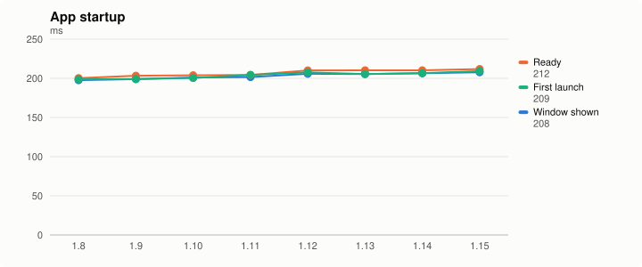
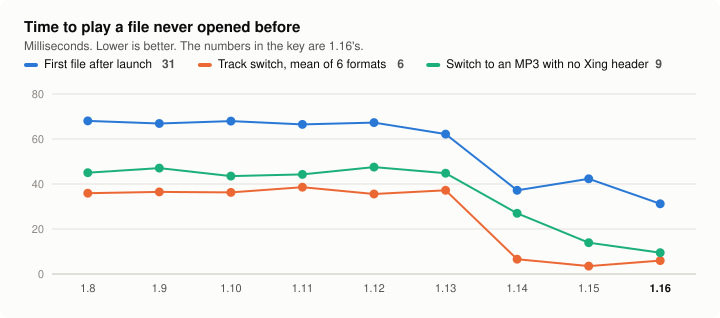
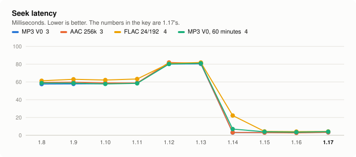
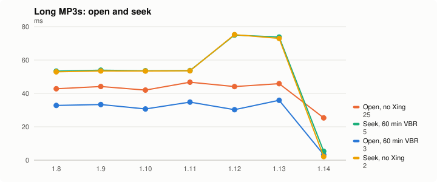
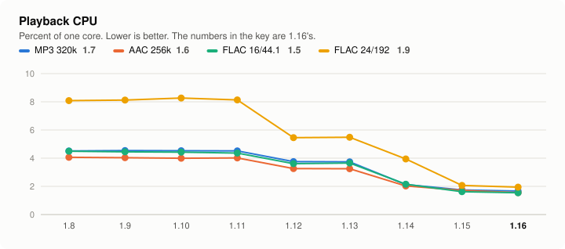
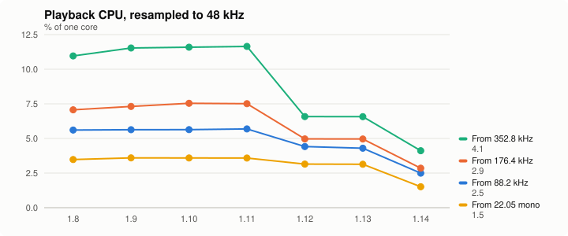
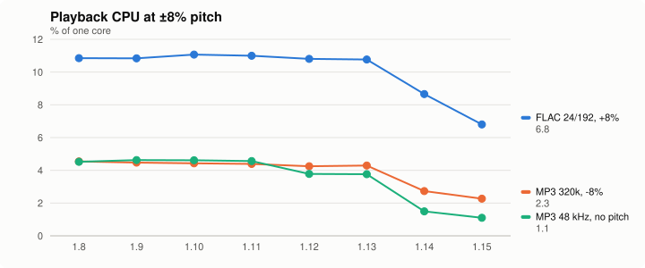
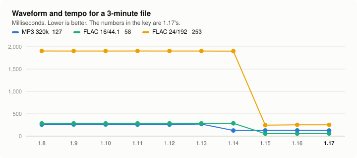
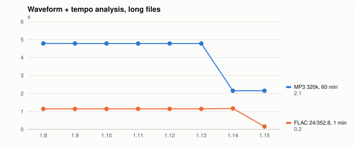
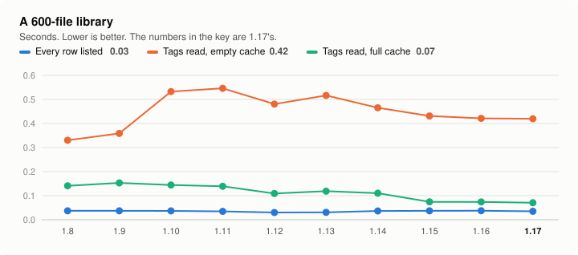
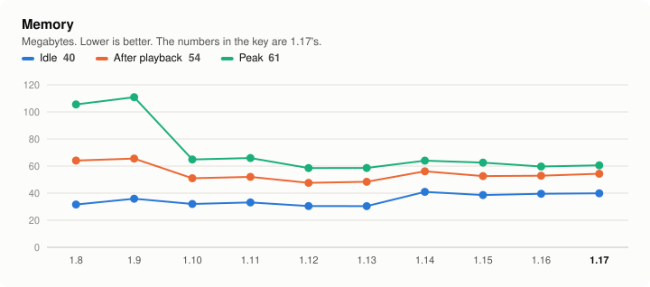
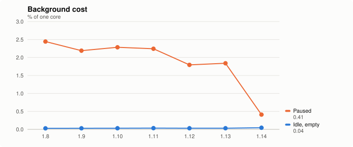
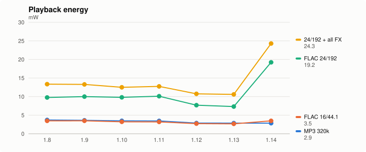
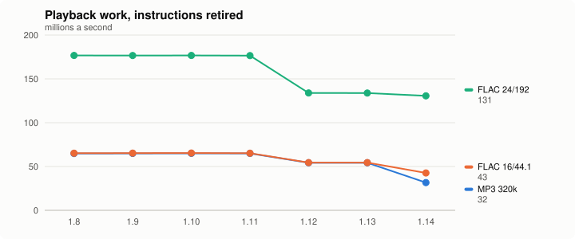
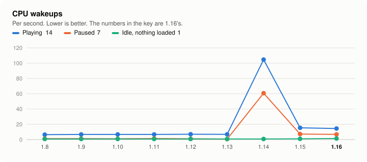

### Components

The component benchmarks, VibeBenchComponents, built against each version's own code and run on one machine (Apple M4 Max, 64 GB, macOS 27.0): the code under each feature, without the app around it. A missing point means that benchmark has no stored result for the version; a version marked pre-release was measured before its release was tagged.

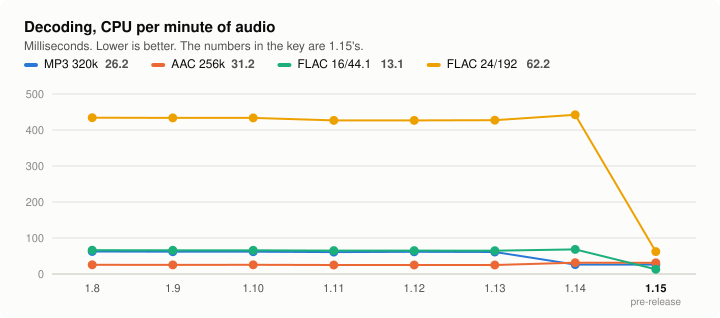
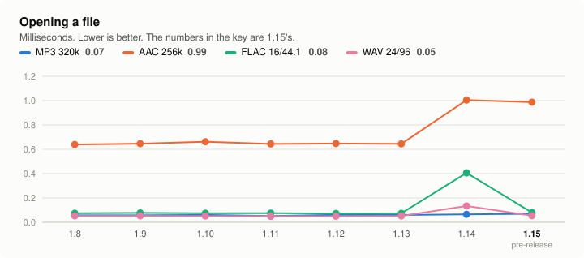
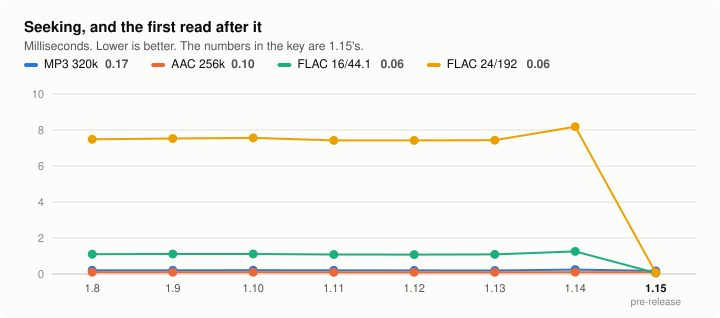
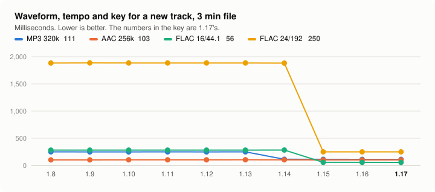
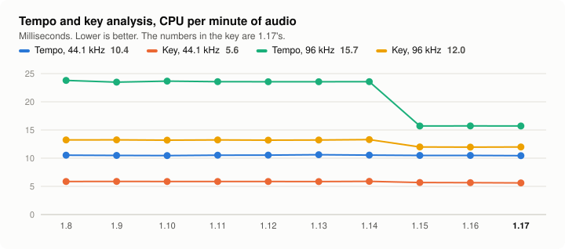
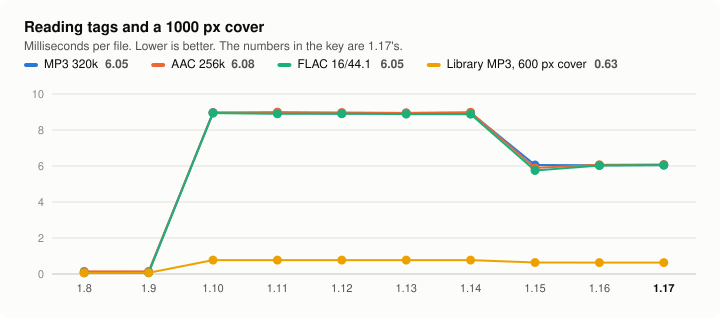
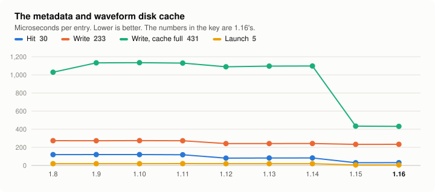
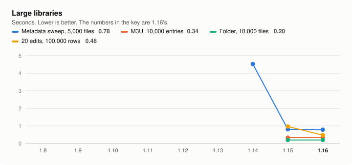

<!-- performance:end -->

## October 2026 performance pass

Measured on an Apple M4 Max with 64 GB of memory, macOS 27.0.1 and Xcode 27.0. The initial baseline was `54351183`. After the Spectrum color-window change in #244, the branch was rebased and the component comparisons were repeated against `2e8059a2`. Both sides use the same benchmark harness and the shipping `-Os` settings. This pass is separate from the release charts above.

The initial survey covered 134 component benchmarks. It covered opening, decoding, seeking, playback stages, analysis, caches, library loading and UI work. Two new cases measure Spectrum with display gain at -6 dB and +6 dB. The final comparison covered all 136 cases.

Spectrum now mixes RGB and brightness in one SIMD vector. A strip with one bar per pixel skips the color scratch and interpolation. The band renderer also keeps its completed waveform's fixed normalization reference. Resizing no longer repeats that scan. The iOS completion gain reads the same reference.

The waveform comparison alternates baseline and changed binaries for five rounds of twenty repetitions. Each resize repetition draws 60 frames from 700 to 936 points at 2x backing scale. These are CPU and instruction measurements. They do not measure GPU frame completion.

| Spectrum resize case | Instructions before | Instructions after | CPU before | CPU after |
| --- | ---: | ---: | ---: | ---: |
| Normalized | 138.7 million | 102.0 million | 5.7 ms | 4.3 ms |
| Gain -6 dB | 136.3 million | 123.5 million | 5.4 ms | 5.0 ms |
| Gain +6 dB | 136.3 million | 123.5 million | 5.4 ms | 4.9 ms |

The normalized case uses 26% fewer instructions and 24% less CPU time. The gain cases use 9% fewer instructions and 7–8% less CPU time. Before #244, the same changes measured 30% fewer instructions and 25–28% less CPU time in the normalized case. The table above includes #244 on both sides. Other waveform styles have unchanged instruction counts within measurement variation. Their CPU timings vary between batches. An apparent oversampling slowdown reversed in an isolated repeat. It did not reproduce as an instruction increase.

The saved waveform envelopes, masks, bakes and Spectrum strips are byte-identical. Strip checks include widths below and above the 8,192-bar cap. A new test covers normalization across resizes, track changes, partial waveforms and empty views.

The app suite also ran startup, a 600-file library and playback during the initial pass against `54351183`, before #244. These are diagnostic observations from one pass per version. CPU scheduling and filesystem cache state affect them. They do not establish improvements outside the renderer.

| App observation | Before | After |
| --- | ---: | ---: |
| Fresh-state window, median of 3 launches | 243 ms | 214 ms |
| Warm window, median of 10 launches | 238 ms | 213 ms |
| 600-file library, rows listed | 42 ms | 86 ms |
| 600-file library, cold metadata scan | 377 ms | 320 ms |
| 600-file library, warm metadata scan | 74 ms | 72 ms |
| First MP3 playback after launch | 15.4 ms | 13.5 ms |
| MP3 playback, percent of one CPU core | 1.31% | 1.50% |
| FLAC 24/192 playback, percent of one CPU core | 1.70% | 1.08% |
| Seek stalls across six file cases | 0 | 0 |

Average seek latencies per file were 1.4–2.9 ms. The run included hour-long MP3s, an MP3 without Xing, high-rate FLAC, FX and pitch changes. Playback instructions were close despite the CPU-time variation. No startup, loading or playback speedup is claimed.

The audio path already uses Accelerate and SIMD for mixing, resampling, metering and analysis. The high-rate FLAC profile spends most decoder time in the existing NEON residual decoder. The Detailed resize profile spends much of its time in Core Graphics path construction. Spectrum with nonzero display gain still spends substantial time in `powf`.

Broader SIMD rewrites of waveform energy windows did not improve the measured work. A whole-target `-O3` build also showed no convincing general gain. Those experiments were discarded. The retained changes consolidate the normalization scan and remove the common strip's intermediate color pass.

Validation passed 2,192 unit tests and 172 audio pipeline tests after the rebase. The macOS and iOS Release analyzers were clean. The iOS Debug build passed. One metadata retry test failed during the initial unit run and passed in the full reruns.

Live macOS checks covered resizing, normalization, gain, track changes and both appearances. All four consistency checks passed. iOS performance was not measured on a device.

To repeat the component comparison:

```bash
python3 .claude/skills/vibe-perf/scripts/perf.py compare 2e8059a2 --filter '^ui-waveform\.' --rounds 5 --reps 20
```

## How it works

The numbers above come from two benchmark suites, each run unchanged against every release. Their job is to show a regression or an improvement between versions, so everything about them is held fixed except the app's own code. The **app benchmarks** (`scripts/bench/`, this section) launch each version's own app and drive it; the **component benchmarks** (the `vibe-perf` skill, [below](#the-component-benchmarks)) run each version's production code in-process, without the app.

```bash
make bench-releases VERSIONS="1.16"         # a new release: both suites at tag v1.16, this page redrawn
make bench-releases VERSIONS="HEAD"         # this checkout before its release, charted as "<its version> pre-release"
make bench-releases VERSIONS="1.16=<ref>"   # any other commit, under that version
make bench-releases                         # every version on this page again, e.g. on a new machine
make bench-app VERSIONS="1.16"              # the app benchmarks alone
make bench-components-releases              # the component benchmarks alone (no app launches)
make bench-report                           # this page's charts and table from results.json alone
```

A version is a release tag (`1.16` means `v1.16`), a version at a commit (`1.16=<ref>`), or a bare ref such as `HEAD`, which is labelled with the version its own `project.yml` declares. **A version whose `v<version>` tag does not exist yet is a pre-release**: it is stored and charted, labelled `1.16 pre-release`, until a run at the tag replaces it.

A version takes about half an hour on an M4 Max, longer on a slower Mac (five repetitions of every scenario; `ARGS="--reps 1"` for a quick look). The suite launches the app seventeen times per repetition and each launch takes focus, so leave the Mac alone while it runs, and put Bluetooth headphones away: the app is held to the built-in speakers, but a headset that is the system default can still be pulled in by the OS. It needs `ffmpeg` (`brew install ffmpeg`) for the corpus, generated once into `build/bench/corpus`.

### What is held fixed

- **The build.** `build-version.sh` checks the tag out into its own worktree and uses that version's Release configuration (`-Os` in the measured releases, `NDEBUG`, no `NSAssert`) with `DEBUG=1` added back so the debug command channel is compiled in, `VIBE_VERBOSE_LOGGING=0` (betas carry instrumentation a release does not), no App Sandbox, its own bundle ID, `com.commonwealthrecordings.Vibe.bench`, and its own process name, `VibeBenchApp`. Other sessions' tooling (vibe-debug's `launch.sh`) kills any process named `Vibe`, which would end a measurement mid-run.
- **The state.** Every scenario starts from an empty home (`CFFIXED_USER_HOME`), so caches are cold unless the scenario says warm. That moves caches but not preferences, which `cfprefsd` keeps in the real home whatever the home variable says; so the bench builds carry their own bundle ID, and the runner resets that preferences domain before every scenario and seeds it. Nothing touches the installed app's container.
- **The audio device.** The real output path on the built-in speakers, silent: every launch passes `--silent`, so the output unit drives the device and its clock while the samples are zeroed after the meter. Every version's saved output device is seeded as the speakers (`AudioPlayer.deviceUID`, the same key in all of them) with bit-perfect and exclusive output off in the builds that have them (1.12 on), and the runner refuses to open a file until `dump_state` shows the app bound to the speakers with bit-perfect off. Every launch also passes `-NSAppSleepDisabled YES`.

  The speakers run at 48 kHz, so every file not at 48 kHz is resampled, 44.1 kHz included.

  Not `--no-audio-hw`. Its debug pump stands in for the device with a 20 ms timer. In 1.8 it drives AVAudioEngine's offline manual rendering, where a track switch or seek under load can take tens of seconds that no real device shows. Measure the real path.
- **The corpus.** Generated deterministically by `bench.py` with ffmpeg into `build/bench/corpus` (1.4 GB): decorrelated pink noise under a 120 BPM kick — broadband, so lossless files barely compress and decoding is at its worst — each tagged format carrying a 1000 px cover (WAV has none). Fifteen playback files: the everyday formats at 3 minutes (MP3 320k and V0, AAC 256k, FLAC 16/44.1, 24/96 and 24/192, WAV 24/96); MP3 at its worst (an hour at 320k and at V0, ten minutes of VBR with no Xing header, so no seek table and no frame count, and 48 kHz, the one MP3 not resampled); and the resampler at awkward ratios (FLAC 24/88.2, 24/176.4, 24/352.8 DXD, and 16/22.05 mono, upsampled). Plus a 600-file library: 30 albums × 20 tracks of MP3, FLAC and AAC, every file tagged with a 600 px cover. `results.json` records a hash of it.
- **The load.** Before every scenario the runner waits until the whole machine has been at least 80% idle for three seconds running (`top`; `ARGS="--idle <percent>"`), and records that idle level in `results.json`. Another workload would inflate every number, unevenly across cores, and chart as a regression.
- **The machine.** Results are only comparable from one machine. `results.json` records the chip, memory, macOS and Xcode per version, and the report charts only versions measured on the newest entry's machine and corpus. After a change of either, `make bench-releases` with no `VERSIONS`. A run that would leave versions measured elsewhere off the page refuses before it starts, and says what differs; `ARGS="--new-machine"` overrides it.

**Which build each version is.** A version is its release tag, or the commit it was measured at. `results.json` records the ref, the commit and `prerelease` for every entry. The component results still hold 1.14 at `1.14-beta3` (`8ae57716`) until a run at `v1.14` replaces it.

**Patches.** 1.8 and 1.9 lack `dump_metadata_progress`, the channel verb the library scan settles on. `scripts/bench/patches/<version>.patch` backports it. It reads state and changes nothing. No other version is patched.

### How each number is taken

Every metric is the median of five repetitions, each in a fresh app launch; the noisiest ones are themselves medians or means over many samples within a repetition (below). Lower is better throughout.

The suite drives the app through the debug command channel with its own client, which speaks the channel's wire format; it polls response files every 0.2 ms. The observed command-file removal starts the command intervals. Startup is timed from process spawn. Time to play and seek latency are estimated from the command-file removal time and the reported playback position. Subtracting the position reduces polling delay. These are render-start estimates, not measurements of sound reaching the listener. Scheduling and output buffering limit their precision.

So the suite polls gently, every 25 ms. `dump_state` runs on the app's main thread. A tight loop sends thousands of requests a second, pins the main thread, and measures the benchmark instead of the app.

One source change the build makes to every version, for the channel alone: in `Vibe/Debug/`, `NSTemporaryDirectory()` reads `VIBE_DEBUG_TMPDIR` first. An unsandboxed app's temp dir is the shared per-user one, and unrelated entries add work to every channel scan.

CPU, memory, wakeups and energy are read from outside with `proc_pid_rusage`, the same in every version: CPU time over a window as a percentage of one core, `phys_footprint` for memory.

| Metric | Scenario |
| --- | --- |
| **App startup** | Process spawn to the first on-screen window (`scripts/bench/probe.swift`, from the window server, no permission needed), and to the first channel reply. *Warm* is the median of ten relaunches over the same home; *first launch* the median of three, each into an empty home with reset preferences. |
| **Idle cost** | CPU %, wakeups/s and footprint over 5 s, 4 s after a first launch with nothing loaded. *Paused* measures 5 s after a 3 s wait with a loaded track paused. |
| **Time to play** | `open` of a file never opened before (cold metadata, art and waveform) to the first rendered audio. The first, MP3 320k CBR, is the first play after launch, so it includes starting the output; the other six are track switches from a playing file: MP3 V0 VBR, AAC 256k, FLAC 16/44.1, FLAC 24/96, FLAC 24/192, WAV 24/96. A version that keeps its output running across a switch (1.14 on) plays the next file in a few milliseconds. The long and resampler-stress files below are opened the same way, and their times are recorded too. |
| **Playback CPU** | 8 s of steady playback of every one of the fifteen files, measured after four consecutive 0.25 s samples below 15% of a core. This is a low-CPU heuristic, not proof that analysis has ended. If the 120 s wait expires, the runner warns and still measures. The same window gives *playback energy* (the process's energy over it, as `proc_pid_rusage` reports it), *playback work* (instructions retired a second, steadier than CPU time) and *wakeups* while playing. The FX worst case is FLAC 24/192 with reverb, delay, short delay and low kill all on; the pitch-fader cases hold the varispeed at +8% on FLAC 24/192 and −8% on MP3 320k, a non-integer ratio on top of the rate conversion. |
| **Seek latency** | 40 seeded seeks per file, each from the app taking the command to audio rendering past the target, the mean per repetition: MP3 V0, AAC and FLAC 24/192 at 3 minutes, and the hour-long MP3s and the MP3 without a Xing header, where a seek deep into the file is the worst case. |
| **Waveform analysis** | `file_cache` on a cleared entry: the full decode, waveform and tempo analysis, until the entry is on disk. MP3 320k, FLAC 16/44.1 and FLAC 24/192 at 3 minutes; an hour of MP3; a minute of DXD. |
| **Library** | `open` of the 600-file folder into an empty cache: until every row is listed, and until every row's metadata has been read (`dump_metadata_progress`). *Warm* repeats the scan in a relaunch over the filled cache. The CPU seconds it cost and the footprint afterwards and at peak are recorded too. |

`results.json` keeps every repetition's raw value under `samples` beside the median.

### The component benchmarks

The second set of charts is the code under each feature, without the app around it. `Tests/BenchComponents/`'s VibeBenchComponents drives the production code in-process: the player's file reader opening, decoding and seeking, the waveform pass with tempo and key, the analyzers alone, the pitch fader's converter, the metadata parse with its cover art, the disk cache, and the large-library operations. `make bench-components-releases`, or `make bench-releases` after the app benchmarks, runs it against every version into `results.json`'s `components` section. No app launches, so the Mac can be in use.

Today's harness is built against every version's own code, and a benchmark file a version cannot compile is left out. Some benchmarks therefore start later: the level meter from 1.10, the metadata sweep from 1.14, the playlist-file, folder-walk and playlist-edit benchmarks from 1.15, the pitch converter from 1.16. The `vibe-perf` skill explains how `perf.py releases` grafts the harness onto each version.

Each number is the median of five runs of one process per version, after a warm-up. Decoding, analysis and the pitch converter are CPU time per minute of the audio, opening and seeking CPU time per operation, the waveform pass wall time (it pipelines across two threads), the metadata parse, the disk cache and the libraries wall time per file, entry or job. The machine is recorded separately from the app benchmarks', and these charts compare only versions measured on one machine. CPU time and instruction counts are kept beside wall time in `results.json`. Compare their run-to-run variation before attributing a small difference to the code.
