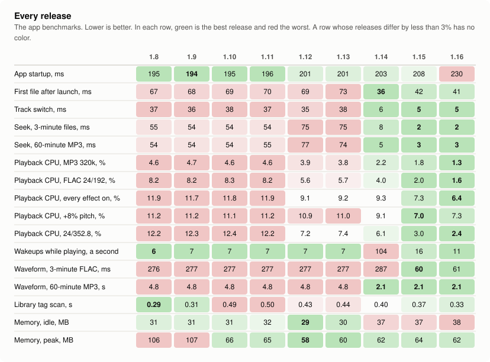
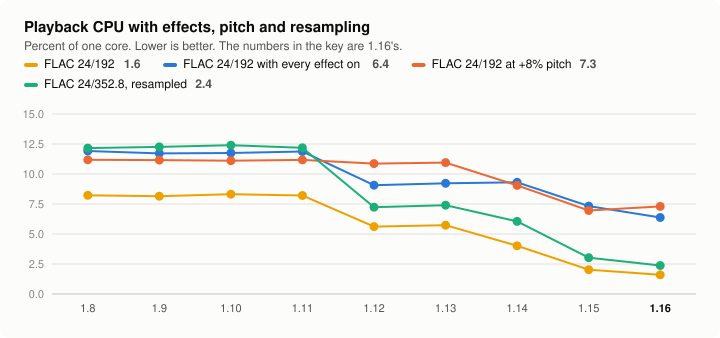
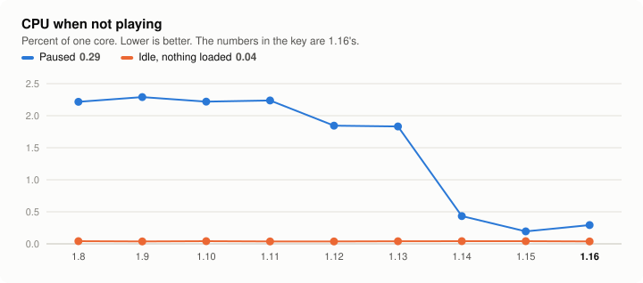

# Performance

Every release of Vibe runs the same benchmarks, on the same Mac. That shows what got faster, what got slower, and which change did it. This page has the results, and the reasons behind the big moves.

There are two kinds of benchmark. The app benchmarks launch each release's own app and play real files through the speakers. The component benchmarks run the code under each feature directly, with no app around it. Lower is better on every chart and table here.

<!-- performance:begin -->

The app benchmarks ran on an Apple M2 Pro with 32 GB of memory and macOS 27.0.1. The component benchmarks ran on an Apple M4 Max with 64 GB of memory and macOS 27.0. A version marked pre-release was measured before its release was tagged.



<!-- performance:end -->

## Playing a track

In 1.14, Vibe's own audio engine replaced Apple's AVAudioEngine. It plays straight to the output device.

**Why:** Vibe's engine keeps the output running when the track changes. The next track only has to open its file and start decoding. With AVAudioEngine, a track switch took about 36 ms.

**The data:** a track switch now takes about 3 ms. The first file after launch still has to start the output. It takes about 40 ms. The slow case is an MP3 with no Xing header. That file has no frame count and no seek table. Opening it takes more work. App launch has stayed near 200 ms in every release. It has crept up by about 10 ms since 1.8.


## Seeking

The 1.14 engine seeks without stopping the output. In 1.15, Vibe's FLAC decoder replaced Apple's.

**Why:** Apple's FLAC decoder ignores the seek table in a FLAC file. To seek into a part it hasn't read yet, it reads the file from the start up to that point. Vibe's decoder uses the seek table, or bisects the file when there isn't one. [Audio quality](audio-quality.md#the-flac-decoder) has the rest of that decision.

**The data:** a seek in a 3-minute file went from about 55 ms to 2 ms. 1.12 made every seek about 20 ms slower, and 1.14 took that back along with the rest. FLAC 24/192 still took 19 ms in 1.14, because of Apple's decoder. With Vibe's it takes 2 ms. The CPU behind one FLAC 24/192 seek went from 8 ms to 0.06 ms.


## Decoding

Vibe's decoders replaced Apple's for MP3 in 1.14, and for FLAC, WAV and AIFF in 1.15. In 1.16, libvorbis replaced Apple's Vorbis decoder. AAC still uses Apple's decoder.

**Why:** they keep every bit of the audio and use less CPU. Each one is measured against Apple's decoder in [audio quality](audio-quality.md).

**The data:** decoding a minute of MP3 went from 61 ms of CPU to 26 ms. A minute of FLAC 24/192 went from 442 ms to 62 ms. AAC got about 25% more expensive in 1.14. That's when Vibe started asking Apple's AAC decoder for 32-bit float instead of 16-bit. The extra cost buys the precision described in [lossy files and bit depth](audio-quality.md#lossy-files-and-bit-depth).


## Playback CPU

Four releases cut the CPU it takes to play a file:

- 1.12 made the UI's playback updates cheaper. Formatting the time readout had been most of each update.
- 1.14 brought Vibe's own engine, and its MP3 decoder and resampler.
- 1.15 brought Vibe's FLAC, WAV and AIFF decoders, and slowed the player's timer from 100 checks a second to 10.
- 1.16 replaces Apple's Varispeed with Vibe's own pitch converter. It sounds much cleaner. It costs about three times as much CPU as Apple's. That's still a fraction of a percent of a core. [Audio quality](audio-quality.md#the-pitch-fader) has the numbers. 1.16 isn't on these charts yet.

**Why:** a music player should cost close to nothing during playback. The savings matter most on a laptop battery.

**The data:** MP3 and FLAC 16/44.1 went from about 4.5% of a core to about 1.7%. FLAC 24/192 went from 8.1% to 2.1%. The speakers in these tests run at 48 kHz. Every other rate gets resampled, 44.1 kHz included. FLAC 24/352.8 needs the most resampling, and it went from 12% to 3.1%. With every effect on, CPU fell less, because the effects themselves are most of that work.




## When nothing is playing

When it's paused or idle, Vibe should do close to nothing. With nothing loaded, the 1.14 engine does no work at all.

**Why:** an app that wakes the CPU often keeps it from sleeping, even if each wakeup is cheap. That costs battery.

**The data:** CPU while paused went from 2.2% of a core to 0.19%. 1.14 got one thing wrong. Its player timer ran 100 times a second whenever a track was loaded, playing or paused. That took wakeups while playing from 7 a second to 105. It also raised the energy of playing FLAC 24/192 from 9.9 mW to 16.5 mW, even though CPU went down. In 1.15 the timer runs 10 times a second. It goes back to 100 only when a fade, a track change or the end of a file is coming up. Wakeups while playing dropped to 15, and FLAC 24/192 now takes 4.0 mW.




## Waveform and tempo

A new track gets a waveform and a tempo. Both come from one pass that decodes the whole file. Since 1.15, files at 88.2 kHz and up are converted down to 44.1 or 48 kHz before tempo detection.

**Why:** the pass is mostly decoding. The faster decoders did most of the work. Tempo detection works in samples. A 96 kHz file cost twice as much as the same music at 48 kHz. On 150 test tracks converted to 96 kHz, tempo accuracy stayed at 82.3%.

**The data:** a 3-minute MP3 went from 250 ms to 118 ms with the new MP3 decoder. A 3-minute FLAC went from 279 ms to 61 ms with the new FLAC decoder. A 60-minute MP3 went from 4.8 s to 2.1 s.


## Libraries and tags

Vibe has no library to import. When you open a folder, it lists the files right away. Then it reads tags and cover art in the background. It caches what it reads on disk, keyed by each file's size and modification time.

**Why:** you can open any folder and play right away, and the second time is faster.

**The data:** since 1.10, reading a file's tags also makes the smaller copies of its cover that the app shows. That's the jump at 1.10 in the second chart. 1.15 halved that cost. It decodes the JPEG at a smaller size first, then scales it with vImage. 1.15 also made the disk cache faster. A first scan of the 600-file library takes 0.36 s. A scan with a full cache takes 0.08 s.


## Memory

Peak memory fell from 107 MB to 68 MB in 1.10. That release fixed several leaks and reworked library and artwork loading. It's 64 MB now. Idle memory went up from 30 MB to 41 MB in 1.14 with the new engine. It's back down to 37 MB.


## Drawing the waveform

In October 2026 (#248), the Spectrum waveform style got cheaper to draw. Spectrum then mixed its color and brightness in one SIMD vector. A strip with one bar per pixel skipped the color interpolation. A finished waveform remembers the loudest of each band's 1,024 columns. Resizing doesn't scan for it again.

**Why:** resizing the window redraws the waveform every frame. Spectrum was the most expensive style to resize.

**The data:** resizing a normalized Spectrum waveform takes 26% fewer instructions and 24% less CPU. It went from 138.7 to 102.0 million instructions, and from 5.7 to 4.3 ms. With display gain at −6 or +6 dB, it takes 9% fewer instructions and 7–8% less CPU. Each resize draws 60 frames from 700 to 936 points wide at 2x. The saved envelopes, masks and strips were byte-identical to before. Since #294, Spectrum draws a picture at fixed zoom steps, and the strip is gone. These are CPU and instruction counts on an M4 Max. They don't measure the GPU, and iOS wasn't measured on a device.

Two other ideas didn't help, and were dropped. Rewriting the waveform's energy windows with more SIMD didn't reduce the work. Building the whole app with `-O3` showed no clear gain either. To repeat the comparison:

```bash
python3 .claude/skills/vibe-perf/scripts/perf.py compare 2e8059a2 17c92b91 --filter '^ui-waveform\.' --rounds 5 --reps 20
```

## More charts

These component charts don't need a section of their own.

<details>
<summary>Opening files, the waveform pass, tempo and key, the disk cache, and large libraries</summary>


</details>

## How it's measured

Both suites run unchanged against every release. Everything is held fixed except the app's own code. A difference between two versions comes from the code. The app benchmarks live in `scripts/bench/`. The component benchmarks belong to the `vibe-perf` skill.

```bash
make bench-releases VERSIONS="1.16"         # a new release: both suites at tag v1.16, and this page redrawn
make bench-releases VERSIONS="HEAD"         # this checkout before its release, charted as "<its version> pre-release"
make bench-releases VERSIONS="1.16=<ref>"   # any other commit, under that version
make bench-releases                         # every version again, for example on a new machine
make bench-app VERSIONS="1.16"              # the app benchmarks alone
make bench-components-releases              # the component benchmarks alone, with no app launches
make bench-report                           # this page's charts and table from results.json alone
```

A version is a release tag (`1.16` means `v1.16`), a version at a commit (`1.16=<ref>`), or a ref such as `HEAD`. A ref takes the version its own `project.yml` declares. If the `v<version>` tag doesn't exist yet, the version is a pre-release. It's charted as `1.16 pre-release` until a run at the tag replaces it. `results.json` records the ref, the commit and `prerelease` for every entry. The component results still hold 1.14 at `1.14-beta3` (`8ae57716`) and 1.15 at a pre-release commit (`1057c2ae`).

`scripts/bench/report.py` draws every chart and the release table. Each section above shows its charts by file name. When a chart is new, `make bench-report` says the page doesn't show it yet. Add it to the section it belongs to.

One version takes about half an hour on an M4 Max, and longer on a slower Mac. That's five repetitions of every scenario. Use `ARGS="--reps 1"` for a quick look. The suite launches the app seventeen times per repetition, and each launch takes focus. Leave the Mac alone during a run, and put Bluetooth headphones away. The app is held to the built-in speakers, but a headset that is the system default can still get pulled in. The corpus needs `ffmpeg` (`brew install ffmpeg`). It's generated once into `build/bench/corpus`.

### What is held fixed

- **The build.** `build-version.sh` checks the tag out into its own worktree and builds that version's Release configuration. That means `-Os`, `NDEBUG` and no `NSAssert`. It adds `DEBUG=1` back to compile in the debug command channel. It sets `VIBE_VERBOSE_LOGGING=0`, because betas carry logging a release doesn't. It turns off the App Sandbox. The build gets its own bundle ID, `com.commonwealthrecordings.Vibe.bench`, and its own process name, `VibeBenchApp`. Other tools (vibe-debug's `launch.sh`) kill any process named `Vibe`. That would end a run partway through.
- **The state.** Every scenario starts from an empty home (`CFFIXED_USER_HOME`). Caches start cold unless the scenario says warm. `cfprefsd` keeps preferences in the real home whatever that variable says. So the runner resets the bench bundle ID's preferences before every scenario, then seeds them. Nothing touches the installed app's container.
- **The audio device.** Every run plays through the built-in speakers, silently. Each launch passes `--silent`. The output unit drives the device and its clock, and the samples are zeroed after the meter. Every version's saved output device is seeded as the speakers (`AudioPlayer.deviceUID`, the same key in all of them). Bit-perfect and exclusive output are off in the builds that have them (1.12 on). The runner won't open a file until `dump_state` shows the app on the speakers with bit-perfect off. Every launch also passes `-NSAppSleepDisabled YES`. The runs don't use `--no-audio-hw`. Its debug pump stands in for the device with a 20 ms timer. In 1.8 that pump drives AVAudioEngine's offline rendering, where a track switch or seek under load can take tens of seconds that no real device shows.
- **The corpus.** `bench.py` generates it with ffmpeg into `build/bench/corpus`, the same every time (1.4 GB). The audio is pink noise under a 120 BPM kick. It's broadband. Lossless files barely compress, and decoding is at its worst. Each tagged format carries a 1000 px cover. WAV has none. There are fifteen playback files. The everyday formats are 3 minutes long: MP3 320k and V0, AAC 256k, FLAC 16/44.1, 24/96 and 24/192, and WAV 24/96. MP3 at its worst is an hour at 320k and at V0, ten minutes of VBR with no Xing header, and a 48 kHz file, the one MP3 that isn't resampled. The resampler gets awkward ratios: FLAC 24/88.2, 24/176.4, 24/352.8 and 16/22.05 mono. There's also a 600-file library of 30 albums with 20 tracks each, in MP3, FLAC and AAC, each with a 600 px cover. `results.json` records a hash of the corpus.
- **The load.** Before every scenario, the runner waits until the whole machine has been at least 80% idle for three seconds (`top`, or `ARGS="--idle <percent>"`). It records that idle level in `results.json`. Another workload would inflate every number, unevenly, and show up as a regression.
- **The machine.** Results only compare on one machine. `results.json` records the chip, memory, macOS and Xcode for each version. The page charts only the versions measured on the newest entry's machine and corpus. After a change of either, run `make bench-releases` with no `VERSIONS`. A run that would leave versions measured elsewhere off the page refuses to start, and says what differs. `ARGS="--new-machine"` overrides it.

**Patches.** 1.8 and 1.9 lack `dump_metadata_progress`, the channel command the library scan waits on. `scripts/bench/patches/<version>.patch` backports it. It only reads state. No other version is patched. One source change goes into every version's build, for the channel only. In `Vibe/Debug/`, `NSTemporaryDirectory()` reads `VIBE_DEBUG_TMPDIR` first. An unsandboxed app's temp folder is the shared per-user one, and unrelated files there slow every channel scan.

### How each number is taken

Every number is the median of five repetitions, each in a fresh launch. The noisiest ones are themselves medians or means of many samples within a repetition. `results.json` keeps every repetition's raw value under `samples`.

The suite drives the app through the debug command channel with its own client. It checks for response files every 0.2 ms. It polls `dump_state` only every 25 ms, because `dump_state` runs on the app's main thread. A tight loop would pin the main thread and measure the benchmark instead of the app. Each command's timing starts when the app removes the command file. Time to play and seek latency subtract the reported playback position. That takes out the polling delay. They estimate when rendering starts, not when sound reaches you. Scheduling and output buffering limit their precision. CPU, memory, wakeups and energy are read from outside the app with `proc_pid_rusage`, the same way for every version. CPU is the time over a window as a percent of one core. Memory is `phys_footprint`.

- **App startup:** process spawn to the first window on screen, and to the first channel reply. `scripts/bench/probe.swift` asks the window server and needs no permission. Warm is the median of ten relaunches over the same home. First launch is the median of three, each into an empty home with reset preferences.
- **Time to play:** `open` of a file never opened before, until the first rendered audio. Its tags, art and waveform are all cold. The first file, MP3 320k, is the first play after launch. It includes starting the output. The other six are track switches from a playing file: MP3 V0, AAC 256k, FLAC 16/44.1, FLAC 24/96, FLAC 24/192 and WAV 24/96. The long and resampler files are opened the same way, and their times are recorded too.
- **Seek latency:** 40 seeded seeks per file, from the app taking the command to audio rendering past the target, as the mean for each repetition. The files are MP3 V0, AAC and FLAC 24/192 at 3 minutes, the hour-long MP3s, and the MP3 with no Xing header. A seek deep into the long files is the worst case.
- **Playback CPU:** 8 s of steady playback of each of the fifteen files. It starts after four 0.25 s samples in a row under 15% of a core. That's a guess that analysis has finished, not proof. If 120 s pass first, the runner warns and measures anyway. The same window gives playback energy (as `proc_pid_rusage` reports it), instructions retired a second, and wakeups while playing. "Every effect on" is FLAC 24/192 with reverb, delay, short delay and low kill. The pitch cases hold the fader at +8% on FLAC 24/192 and −8% on MP3 320k, a non-integer ratio on top of the rate conversion.
- **Idle and paused:** CPU, wakeups a second and memory over 5 s. Idle starts 4 s after a first launch with nothing loaded. Paused starts 3 s after pausing a loaded track.
- **Waveform:** `file_cache` on a cleared entry, until the entry is on disk. That runs the full decode, the waveform and tempo detection. The files are MP3 320k, FLAC 16/44.1 and FLAC 24/192 at 3 minutes, an hour of MP3, and a minute of DXD.
- **Library:** `open` of the 600-file folder with an empty cache, until every row is listed, and until every row's tags are read (`dump_metadata_progress`). The warm scan repeats that in a relaunch with the cache full. The CPU seconds it took and the memory after it and at peak are recorded too.

### The component benchmarks

VibeBenchComponents (`Tests/BenchComponents/`) drives the production code in-process. `make bench-components` compares every compiled case by default. `make bench-components-releases` measures the chart selection into the `components` section of `results.json`. It doesn't launch the app. You can keep using the Mac.

| Path | Component groups | Measured work |
| --- | --- | --- |
| Audio files | `open`, `load`, `decode`, `decode-il`, `decode-window`, `seek`, `skip-forward`, `skip-backward`, `encode-flac` | Open and close, first playable block, full planar and interleaved decode, 30-second window reads, random seeks, five-second skips in both directions, 16- and 24-bit FLAC encoding. MP3 includes dr_mp3 and Apple's decoder. |
| Waveform generation | `waveform*`, `chunker*`, `bpm`, `key` | Full decode and chunking, mono downmix, bands, tempo and key analysis. CUE windows run with and without analysis. Detail reads measure empty storage, hits and eviction where the zoom engine exists. |
| Waveform storage | `waveform-cache` | Real archives read and written through PINDiskCache, with and without bands, for three-minute and hour-long files. Progress snapshots are measured separately at both lengths. So are fresh archive writes and the first draw after a read or a snapshot. |
| Audio processing | `resample`, `pitch`, `levels`, `fx-host`, `fx-render` | Downsampling, upsampling and equal-rate copies in mono and stereo, both pitch implementations, all three meter modes at 48 and 96 kHz, FX hosting, idle FX, each effect and all effects together. |
| Artwork and tags | `metadata`, `metadata-cache-*`, `art-*`, `cachekey` | Tag parsing, real metadata archive reads and writes, embedded image extraction, bounded decoding at 128, 640 and 1024 px, dominant color, thumbnail decode and delivery, thumbnail memory hits, file cache keys. |
| Libraries and caches | `pincache`, `scan`, `walk`, `m3u`, `cue`, `playlist*` | Cache reads, writes and eviction, metadata scheduling, folder walks, M3U resolution, writing and restoration, CUE parsing, single and bulk playlist edits, identity and URL lookups, seeded shuffle and navigation. |
| Waveform drawing | `ui-waveform*` | Every registered style: layer geometry, progress and hover, steady and resizing rasterization, scroll, pinch and track changes. The iOS scrubber's scroll and pinch run at 3x. Full-resolution detail drawing and shared envelope bakes run where their APIs exist. |
| macOS UI | `ui-cell`, `ui-table`, `ui-tick`, `ui-format`, `ui-track`, `settings` | Text drawing, table refresh, artwork placeholders, display formatting and settings interactions. |

The file matrix includes CBR and VBR MP3, MP2, AAC in MP4 and ADTS, FLAC, WAV, AIFF, ALAC, Opus and Vorbis. It covers CAF, Wave64, RF64, float WAV and 5.1 WAV too. It also includes mono at 22.05 kHz, MP3 at 48 kHz, hour-long CBR and VBR MP3s, a ten-minute MP3 without a Xing header, and FLAC at 88.2, 96, 176.4, 192 and 352.8 kHz. These are regular cases in the shared harness, not a separate comparison script.

The workloads are fixed. Elapsed time still varies with scheduling, filesystem caching and CPU frequency. Instruction counts cover all threads in this process. Repetitions reuse warm filesystem pages. They do not measure physical storage throughput or cloud downloads. Drawing includes synchronous CPU rasterization at 2x. The iOS scrubber's zoom cases draw at 3x. GPU work and WindowServer composition run outside these counters. Shared iOS rendering code runs on the Mac here. UIKit layout and device performance need separate measurement. End-to-end player transitions, voice overlap, render deadlines, cloud admission, network waits, output-device changes, FX control ramps and tail expiry remain app or audio-render-suite work. The component suite does not claim to time every application path. A waveform detail case has no 1.15 counterpart. It is reported as version-specific work rather than a speed delta.

Today's harness is built against each version's own code. A benchmark a version can't compile is left out. Some lines start late because of that. The level meter starts at 1.10, the metadata sweep at 1.14, and the playlist-file, folder-walk and playlist-edit benchmarks at 1.15. The pitch converter will start at 1.16. The `vibe-perf` skill explains how `perf.py releases` grafts the harness onto each version.

Each number is the median of five runs, one process per version, after a warm-up. Decoding, analysis and the pitch converter are CPU time per minute of audio. Opening and seeking are CPU time per operation. The waveform pass is wall time, because it runs on two threads. The tag parse, the disk cache and the libraries are wall time per file, entry or job. CPU time and instruction counts sit beside wall time in `results.json`. Check their run-to-run spread before blaming a small difference on the code.
